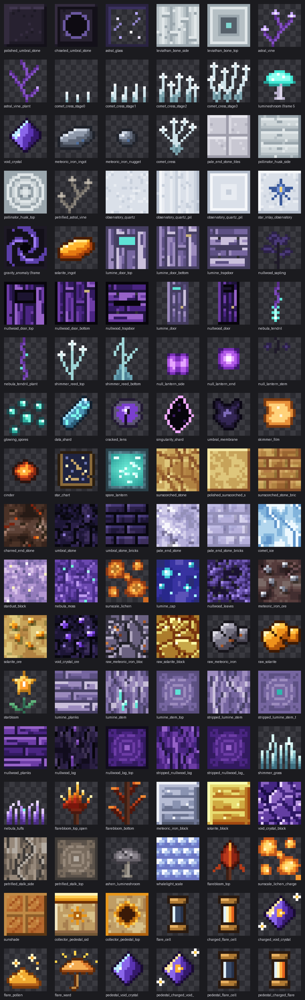

# The Astral End

A Forge mod for **Minecraft Java Edition 26.3** with **Forge 66.0.8** that expands the End
into a sparse, mysterious network of astral islands. The full plan is in
[docs/END_UPDATE.md](docs/END_UPDATE.md).

**Status:** Phase 1 of 9 (blocks, materials and plants). Mod ID: `astralend`.

## What's in the mod so far (Phase 1)

Everything is in the **The Astral End** tab of the creative inventory. Until the new End
biomes arrive (Phase 2 and 3), the natural blocks don't generate in the world yet, so get them
from the creative tab or with `/give @s astralend:<name>`.



| Content | What it does |
|---|---|
| **Umbral Stone** (+ Polished, Bricks, Chiseled, and stairs, slabs and walls) | The dark stone of the Dark Matter Belts. Crafts and stonecuts like deepslate. |
| **Void Crystal Ore** → **Void Crystal** | Mine with an iron pickaxe. Drops a gem like diamond ore, works with Fortune and Silk Touch. 9 make a block. |
| **Meteoric Iron Ore** → **Raw Meteoric Iron** → **Meteoric Iron Ingot** | Needs a diamond pickaxe. Smelt or blast the raw metal. Nuggets and blocks craft like iron. |
| **Stardust** | Sand that **falls up**: it drifts upward until it hits something. Smelts into **Astral Glass**. |
| **Astral Glass** | Dark glass with stars caught in it. Needs Silk Touch to pick up, like glass. |
| **Leviathan Bone Block** | Fossil bone, placed like logs or bone blocks (it rotates to the face you click). |
| **Nebula Moss** | Soft violet ground cover; Lumineshrooms and Starblooms grow on it. |
| **Lumineshroom** | A glowing mushroom (light level 10) whose cap slowly "breathes". Grows on Nebula Moss, End Stone or Umbral Stone. |
| **Starbloom** | A star-shaped flower. Grows on grass, End Stone or Nebula Moss. Makes yellow dye, and Night Vision suspicious stew. |
| **Astral Vine** | Grows upward like twisting vines, and you can climb it. Bone meal makes it grow. |
| **Comet Cress** | A food crop that **hangs from the underside of Stardust** and grows downward. Doesn't need light. Plant the cress itself, like carrots. |

## Quick start: one command for everything

After the one-time setup below (Java 25 plus this project on your computer), everything runs from a
terminal inside this folder with `./dev.sh`:

| Command | What it does |
|---|---|
| `./dev.sh` | Launch Minecraft with your mod (same as `./dev.sh run`) |
| `./dev.sh build` | Build your mod jar into `build/libs/` |
| `./dev.sh source` | Unpack Minecraft's source code, textures and data into `~/minecraft-source` |
| `./dev.sh crash` | Show the start of the newest crash report, to paste when asking for help |
| `./dev.sh repair` | Fix a broken first-time download (errors like `Unexpected end of ZLIB input stream`) |

`dev.sh` finds Java 25 by itself on a Mac, even if another Java is your default.
The very first command downloads and sets up Minecraft, which takes 5–15 minutes. After that, launching
takes under a minute.

## 1. Install the tools (one time)

| Tool | Why | Get it |
|---|---|---|
| **JDK 25** | Minecraft 26.x runs on Java 25 | [Adoptium Temurin 25](https://adoptium.net/temurin/releases/?version=25). On a Mac, pick **aarch64** (Apple Silicon) or **x64** (Intel) and download the **.pkg** installer, not the .tar.gz |
| **An editor** | IntelliJ IDEA Community has the best Gradle support; VS Code or Antigravity also work (see section 3) | [jetbrains.com/idea](https://www.jetbrains.com/idea/download/) |
| **Minecraft Java Edition** | To play your mod for real (not needed for `runClient`) | minecraft.net |
| **Git** (optional) | Version control | git-scm.com |

You do **not** install Gradle yourself. The `gradlew` script in this folder downloads the right version.

## 2. Get this project

```
git clone https://github.com/ggrantrichards/minecraft-forge-mod.git
cd minecraft-forge-mod
./dev.sh build
```

The repository is private: if Git asks for a password, use a GitHub personal access token
(github.com/settings/tokens, with the **repo** box ticked), not your GitHub password.

To start a different mod from scratch instead, download the **MDK** (Mod Development Kit) for your
Minecraft version from <https://files.minecraftforge.net/> and unzip it. This project is that MDK
plus the example content.

## 3. Open it in IntelliJ, which also gets you the Minecraft source

1. IntelliJ → **Open** → select this folder (the one with `build.gradle`) → *Trust project*.
2. Wait for the Gradle sync. **The first sync takes 5–15 minutes.** ForgeGradle downloads
   Minecraft, applies Forge's patches, and **decompiles Minecraft into readable Java source**.
3. When it finishes, you have the Minecraft source code:
   - Press **Shift Shift** (Search Everywhere) and type a class name such as `Block`, `Item`,
     `Player`, `Zombie`, or `Blocks`, then open it.
   - Or **Ctrl+click** (Cmd+click on Mac) any Minecraft class in `AstralEnd.java`.
   - In the Project panel, look under **External Libraries** for the Minecraft/Forge jar.
   If IntelliJ shows a "decompiled .class file" banner, that's fine; it's still readable Java.
   Since 26.1, Mojang ships Minecraft **unobfuscated**, so you see the real names Mojang's
   developers use.
   Reading vanilla code is the most important modding skill: to make something like a
   vanilla thing, find the vanilla thing and copy its approach.

   > You may read and learn from the decompiled code, but you may not redistribute
   > Minecraft's code. Your mod jar contains only *your* code.

To browse **all** of Minecraft as ordinary files instead, run `./dev.sh source`. It unpacks
everything into `~/minecraft-source`: Java code in `net/minecraft/`, textures and models in
`assets/minecraft/`, and recipes, loot tables and tags in `data/minecraft/`. Add that folder to
your editor (**File → Add Folder to Workspace**), then use **Cmd+P** / **Ctrl+P** to open a file
by name (`Zombie.java`, `Blocks.java`, `iron_ore.json`) and **Cmd+Shift+F** / **Ctrl+Shift+F** to
search everything. Treat it as read-only reference and never commit or upload it.

From a terminal instead: `./gradlew build` (Windows: `gradlew.bat build`).

### Using VS Code or Antigravity instead of IntelliJ

1. Install the extensions **Extension Pack for Java** (or at least **Language Support for
   Java by Red Hat**) and **Gradle for Java**. In Antigravity, search for them in its
   extensions panel.
2. **File → Open Folder** → this folder. Say yes to importing the Gradle project, then wait
   for the Java status in the bottom bar to say it's ready. The first import takes 5–15 minutes.
3. To read Minecraft's source, press **Ctrl+T** (Cmd+T on Mac) and type a class name such as
   `Block`, or Ctrl+click a Minecraft class in `AstralEnd.java`. Or run `./dev.sh source` and add
   `~/minecraft-source` to the workspace (see above). If a class opens with no code inside, set
   the `java.contentProvider.preferred` setting to `fernflower`.
4. Run everything from the built-in terminal (**Ctrl+`**): `./gradlew runClient`, or
   `.\gradlew.bat runClient` on Windows.

### Checking your Java

Run these in a terminal. You need a **JDK** (it includes `javac`), not only a Java runtime.

```
java -version        # should say 25
javac -version       # should say javac 25 (if "not found", you only have a runtime, not a JDK)
```

Then, inside this folder, ask Gradle which JDKs it can see:

```
./gradlew -q javaToolchains       # Windows: .\gradlew.bat -q javaToolchains
```

The first time you run a Gradle command here, Forge also sets up Minecraft, so it can take several
minutes. If `gradlew` itself fails with a Java version error, your default `java` is older than 17;
set `JAVA_HOME` to your Java 25 folder.

If that lists a JDK with **Language Version: 25** and **Is JDK: true**, you're set. If not, Gradle downloads one
automatically on the first build.

## 4. Run the game with your mod

- In IntelliJ's Gradle panel (elephant icon, right side): open **astralend → Tasks**, find **runClient**, and double-click it, or
- in a terminal: `./dev.sh` (or `./gradlew runClient`)

A development copy of Minecraft opens with your mod loaded, and you can use it offline.
Make a Creative world, then:
- open the creative inventory and click the **The Astral End** tab (the Void Crystal icon), or
- `/give @s astralend:stardust_block 16`, then place it under a ceiling and watch it rise;
- place Stardust against a ceiling and plant **Comet Cress** on its underside.

Game files for this dev copy (worlds, logs, options) go in `run/`. The full log is
`run/logs/latest.log`; crash reports are in `run/crash-reports/` (`./dev.sh crash` shows the newest).

On a Mac, the client runs with `-XstartOnFirstThread` (set in `build.gradle`). The normal
Minecraft launcher adds this for Mac players; without it the game fails with
"Unable to initialize SDL: No available video device".

## 5. How the project is laid out

```
build.gradle                  Minecraft + Forge versions, run configs
settings.gradle               project name
src/main/java/com/ggrantrichards/astralend/
  AstralEnd.java              entry point (@Mod)
  ModBlocks.java              every block (and its block item)
  ModItems.java               items that aren't blocks
  ModCreativeTabs.java        "The Astral End" creative tab
  block/                      blocks with custom behaviour (Stardust, plants, crops)
src/main/resources/
  META-INF/mods.toml          mod ID, name, version, dependencies
  pack.mcmeta                 required: makes Minecraft load assets/ and data/ below
  assets/astralend/           CLIENT stuff: what things look like
    textures/block/*.png          16x16 PNGs (drawn by tools/textures/make_textures.py)
    textures/item/*.png
    models/block/*.json           e.g. "cube with the same texture on all sides"
    models/item/*.json            e.g. "flat item using this texture"
    items/*.json                  which model to use for each item
    blockstates/*.json            which model to use for each block state
    lang/en_us.json               display names
  data/                       SERVER stuff: game rules
    astralend/recipe/*.json       crafting recipes
    astralend/loot_table/blocks/  what a block drops
    minecraft/tags/block/...      "mineable with pickaxe", "needs iron tool"
tools/
  textures/make_textures.py   draws every texture, plus docs/images/textures.png
  generate_resources.py       writes all the JSON above from one list
  check_resources.py          checks nothing is missing (run before launching)
docs/END_UPDATE.md            the full plan for the mod
```

Rule of thumb: **Java registers that a thing exists and what it does. JSON says what it
looks like, what it's called, how it's crafted, and what it drops.**
Everything uses IDs like `astralend:void_crystal`, where the namespace is your mod ID.

## 6. Adding a new block or item

The JSON files are generated, so you rarely write them by hand:

1. **Java:** register it in `ModBlocks.java` (a block, which also gets an item) or
   `ModItems.java` (an item only). Copy a similar line, like `NEBULA_MOSS` or `VOID_CRYSTAL`.
   Add it to the list in `ModCreativeTabs.java`.
2. **Texture:** draw it in `tools/textures/make_textures.py` (or save a 16×16 PNG into
   `src/main/resources/assets/astralend/textures/block/` or `item/` using Aseprite, Piskel or
   LibreSprite), then run `python3 tools/textures/make_textures.py`.
3. **JSON:** add it to the right list at the top of `tools/generate_resources.py`, then run
   `python3 tools/generate_resources.py`. That writes its blockstate, models, item
   definition, loot table, tags and English name.
4. **Check:** `python3 tools/check_resources.py`. It says exactly what's missing, if anything.
5. `./dev.sh` to see it in game.

The scripts need Python 3 and Pillow (`pip3 install pillow`).

If something shows as a **purple/black checkerboard**, a model or texture path is wrong
(`check_resources.py` finds these). If it shows as **`block.astralend.something`**, its English
name is missing. If **all** your textures, names and recipes are missing and the game warns
"failed to load a valid ResourcePackInfo", `src/main/resources/pack.mcmeta` is missing or broken.

**Automatic checks:** every push to GitHub builds the mod, loads it in a server (checking
recipes, loot tables and tags) and boots the real game client (failing if any model or texture
is missing). Results are on the repository's **Actions** tab.

## 7. Build a jar and play it in real Minecraft

1. `./gradlew build` → your mod is `build/libs/astralend-1.0.0.jar`.
2. Install Forge for 26.3 in your normal launcher: download the **Installer** from
   files.minecraftforge.net, run it, and choose *Install client*.
3. Put the jar in your `.minecraft/mods/` folder.
   - Windows: `%APPDATA%\.minecraft\mods`
   - macOS: `~/Library/Application Support/minecraft/mods`
   - Linux: `~/.minecraft/mods`
4. Pick the **forge** profile in the Minecraft Launcher → Play.

## 8. Renaming the mod

The mod ID `astralend` appears in `AstralEnd.MODID`, `mods.toml` (twice, including
`[[dependencies.astralend]]`), `build.gradle` (the runs), `settings.gradle`, and the
`assets/astralend` and `data/astralend` folder names and every `astralend:` inside the JSON.
Rename the Java package `com.ggrantrichards.astralend` with IntelliJ's Refactor → Rename.

## 9. Where to go next

- Forge docs: <https://docs.minecraftforge.net/>
- Official MDK examples (Mixins, Access Transformers, and more): <https://github.com/MinecraftForge/MDKExamples>
- Forge source: <https://github.com/MinecraftForge/MinecraftForge> (the `26.3` branch)
- Forge Discord and the forums at forums.minecraftforge.net
- What's next for this mod: Phase 2, the first new biome (Nebula Fields). See the roadmap in
  [docs/END_UPDATE.md](docs/END_UPDATE.md).

## Updating to a newer Minecraft version

Change `net.minecraftforge:forge:26.3-66.0.8` in `build.gradle` and the version ranges in
`mods.toml`, then re-sync. Also update `max_format` in `pack.mcmeta` to the new version's pack
formats (listed under `pack_version` in `version.json` inside `~/minecraft-source` after `./dev.sh source`). Minecraft changes its code every version, so expect some fixes.
Forge's changelog and the MDK for the new version show what changed.
