# The Astral End

A Forge mod for **Minecraft Java Edition 26.3** with **Forge 66.0.8** that expands the End
into a sparse, mysterious network of astral islands. The full plan is in
[docs/END_UPDATE.md](docs/END_UPDATE.md).

**Status:** phases 1-9 done: biomes, mobs, the sky and Stellar Flares, structures, live comets, Starforging, and a polish pass. Mod ID: `astralend`.

**Next, Phase 10: the Mojang pass.** Every feature gets held to what a real Mojang End update would
ship: the hazards are defanged (no Flare Burn, no comet landfall, no Stalker void knockback), the
materials consolidate to about three, Starforging gives way to a single smithing-table upgrade (Void
Recall stays, on its own), the Black Hole Guardian, the Watcher, Comet Ice, the Cinder Mite and the
inversion pockets are cut, the science names go, and the missing pieces come in: ties to the vanilla
End (End Cities, chorus, gateways), music and ambience, and a reason to come back. The full list is in
[the plan, section 14.1](docs/END_UPDATE.md#141-phase-10-the-mojang-pass).

**Then Phase 11: new additions.** What a real End update would add, held to the same rules (fix the
End's real problems, build on the vanilla End, a small sharp list, fantasy names, no unfair deaths or
power creep) and keeping the End alien and stagnant, not lush:

- **Biomes:** the vanilla barrens and highlands reworked into the **Ashen Barrens** (Ashdust muffles every
  sound and blocks sculk vibrations) and the **Chorus Thicket** (brittle, bleached Chorus trees, Chorus
  Wood, fall-cushioning Chorus Moss); new **Glimmering Crags** (dark teal **Nightstone**, Resonance
  Crystals) and **Obsidian Wastes** (the Endermen's home, Fossilized End Ships).
- **Mobs:** the **Drifter**, a void mount you hook with a fishing rod or saddle and steer with a Chorus
  Flower on a Stick; the **Weaver**, whose Levitation Webs you can Silk Touch into jump pads; the
  **Keeper**, an End City guardian that grounds gliders only over land; sparse **Chorus Moths**.
- **Materials:** **Resonance Crystal** and **Rift Shards** (mined from island undersides; Rift Thread makes
  an elytra wear 50% slower, nothing more).
- **Blocks:** **Voidgel** (levitation pads), **End Chimes** (stop Endermen teleporting nearby), and the
  **Resonance Anchor** (an Ender Pearl lays a 30-second bridge of light to it).
- **The Resonant Spires**, climbed with webs, Voidgel and shulker bullets, with a **Resonance Vault** at
  the top opened by a Weaver's key: banner patterns, a glowing cosmetic trim and a new music disc.
- **Music and soundscapes** for all of it.

The full spec is in [the plan, section 14.2](docs/END_UPDATE.md#142-phase-11-new-additions).

[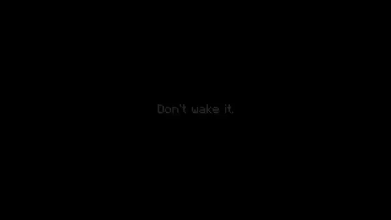](https://youtu.be/ZUQVTpnqRTQ)

**[Watch the trailer](https://youtu.be/ZUQVTpnqRTQ)**

## Get it

The first public build, **1.0.0-beta.1**, is published to Modrinth as
[**The Astral End**](https://modrinth.com/mod/the-astral-end) (a beta: blocks and items may still be
renamed or removed before 1.0, so back up worlds you care about). It needs **Minecraft 26.3** and
**Forge 66** or newer, on both the client and the server. MIT licensed (see [LICENSE](LICENSE)).

Releases go out with the **Release to Modrinth** workflow (Actions > Release to Modrinth > Run
workflow), which builds the mod and runs [tools/release/modrinth.py](tools/release/modrinth.py). The
project page lives in [docs/modrinth/](docs/modrinth/): the icon, the gallery, the description and a
changelog for each version.

## What's in the mod so far

### Phase 9: polish

| The Orrery Bronze family | The Orrery's vault, its Sentinel awake |
|---|---|
| 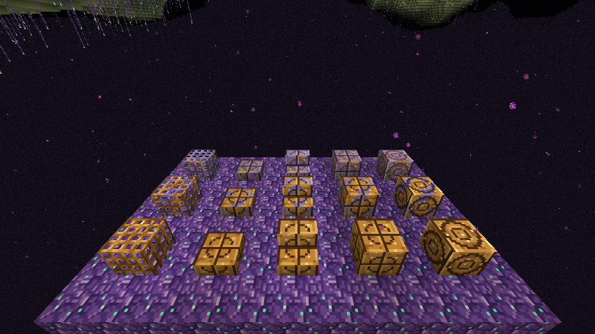 | 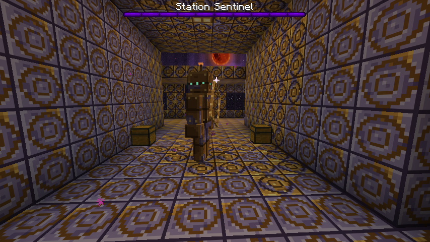 |

Phase 9 went over every feature with one question: *would Mojang ship this, in this form, in a
real End update?* Anything that wasn't up to that was revamped or cut.

**Revamped:**
- **The Abandoned Orrery** (was the "Abandoned Orbital Station"). A space station with crew quarters,
  hydroponics, a docking bay and a power core is science fiction; Minecraft's ancients build with
  craft and magic. It's now the Cartographers' great clockwork **orrery**: a ring gallery with a roost
  of dormant Void Wanderers, a wild garden and the keepers' quarters, round a hub where the **Orrery
  Heart** sits under the orrery's axle and gilded sun. You rekindle the Heart with **Bottled Flares**
  (was "Flare Cells", drawn as batteries; now glass flasks you fill on a Collector Pedestal); its vault
  is sealed by **Bronze Shutters** (was "Bulkheads"), lit by **Orrery Lamps**, and guarded by the
  **Orrery Sentinel**, a clockwork construct whose beam is focused starlight.
- **The Void Wanderer** is a clockwork construct, not a "survey drone": it **studies** you instead of
  scanning, leaves you a **Chart Fragment** (was "Data Shard") - a shard of its star map - and fights
  with homing **starbolts** (shulker bullets you can dodge or knock away) instead of an instant-hit laser.
  Void crystal glints in its seams where "status lights" were.
- **Nothing is left without a use.** The Sentinel's trophy-only "Data Core" is gone (it drops a
  Starforge Template and a Rift Pearl); the Wanderer's **Cracked Lens** now goes into the Portal Lens;
  **Cinder** also makes fire charges.

**Rounded out**, the way Mojang finishes a block or material:
- **Orrery Bronze** gets copper's whole family: **Cut Orrery Bronze**, its **stairs** and **slabs**, and
  **Orrery Bronze Grates**, in all three stages of tarnish. **Honeycomb waxes** any of it so it stops
  aging; an axe scrapes the wax off, or a stage of tarnish. Crafted and stonecut like copper.
- **Nebula Moss Carpet** (two Nebula Moss make three).
- **Glowing Stew** (Lumineshroom, Comet Cress and a bowl): food, and 30 seconds of Night Vision.
- **Star Compass** (a compass with four Starblooms round it): points to the End's central island, the
  way a lodestone compass points to its lodestone. (Ordinary compasses spin in the End.)

**Fitted into vanilla's systems:**
- **Advancements** join the **End** tab as a branch from *Remote Getaway*, as Mojang adds them:
  *Astral Horizons*, *Chart the Stars* (visit all six astral biomes), *Falling Upward*, *Catch a Falling
  Star*, *Iron From the Sky*, *Forged in Starlight*, *Starforged From Head to Toe*, *Not Today, Void*,
  *Hold Still*, *Connect the Dots*, *Say Ahh*, *Something Looks Back*, *Weather the Storm*, *Harvest Moon*,
  *Bottled Sunlight*, *Wind It Up*, *Clockwork Undone*, *Event Horizon*, and the Drift Whale's three.
- **Every recipe unlocks in the recipe book** when you pick up one of its ingredients.
- **Switches are data-pack tags**, like vanilla's: empty `#astralend:sunstorms` to turn flares
  off, `#astralend:live_comets` for comets (and `low_gravity`, `upwells` as before).

**Cut**, because they couldn't be done to that standard (the plan, `docs/END_UPDATE.md`, says why for
each): Echo Logs (Mojang never puts readable lore in the game), new music and the "Leviathan" disc
(they'd need real composed music), a config file (tags do the job), Starfield Glass, Gravity Wells and
Void Traps, the Solar Lantern, the Gravlily and its potion, the Stalker Cloak, carved bone variants,
and the Portal Lens's extra powers.

### Phase 8: Starforging

| The Astral Forge | Forging Radiant onto a chestplate |
|---|---|
| 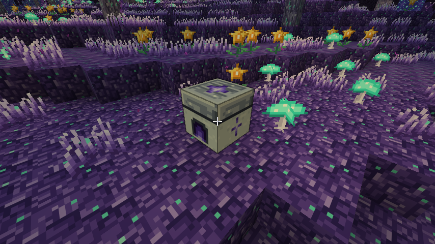 | 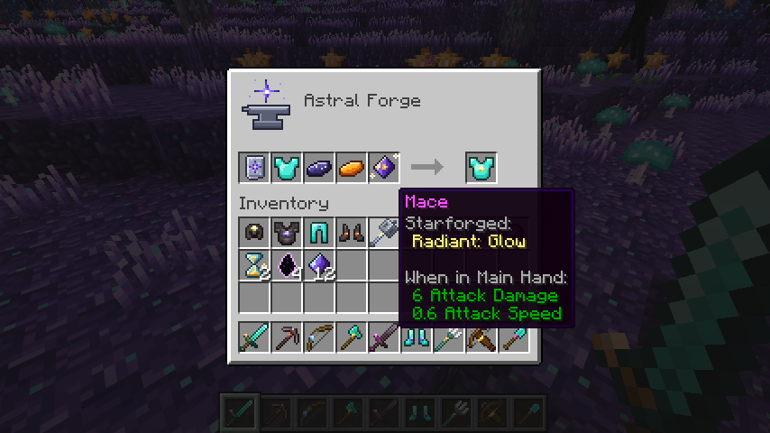 |
| **Upgraded armour, worn** | **Rift Walker boots over the void** |
| 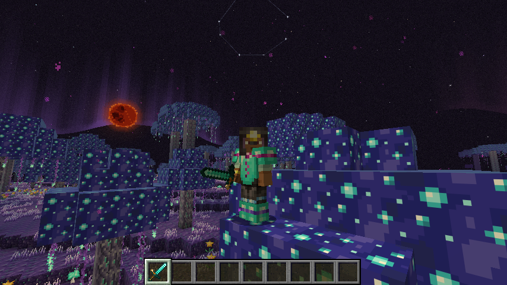 | 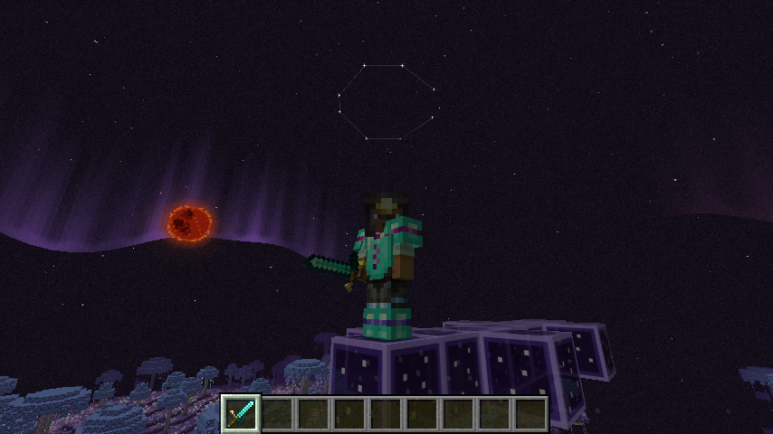 |

Starforging is the late-game upgrade system. Every upgrade is better than none; the choice is
which one goes where. Each one does one clear thing, shown on the tooltip like an enchantment
("Starforged: Radiant: Soak Light"), and works in every dimension. One upgrade per item; forging
a new one replaces the old. Upgrades stack with enchantments.

**How:** build an **Astral Forge** (a Meteoric Iron block, five Observatory Quartz and a Void
Crystal) and put in a **Starforge Template**, the item, **Starforge Alloy** and the upgrade's
material. Templates come from Orrery vaults, maze rewards, Observatory vaults and Solar Arrays,
and copy like smithing templates (7 diamonds and Observatory Quartz make two). Alloy is crafted:
2 Void Crystal, 2 Meteoric Iron Ingots and Glowing Spores.

**What can be upgraded:** diamond and netherite armour, swords, axes and tools, plus bows,
crossbows, tridents and maces (item tags `astralend:starforgeable/*`, so a data pack can add more).
Not elytra.

| Upgrade | Material | Armour | Weapons | Tools |
|---|---|---|---|---|
| **Voidwalker** | Void Crystal + Umbral Membrane | **Boots, Rift Walker:** walk off an edge and tiles of rift form under your feet and a step ahead, cracking and crumbling a second later (over lava too, which comes back). **Chestplate, Void Recall:** right-click a **Rift Pearl** onto it; fall into the void and the pearl is spent to put you back on your last footing. | - | - |
| **Meteoric** | Meteoric Iron Ingot | **Heat Shield:** no fire or lava damage for the first 2 seconds per piece; it recharges after 10 seconds out of the fire. | - | **Smelting:** mined blocks drop smelted (ore to ingots, sand to glass, logs to charcoal). Fortune works; Silk Touch wins. |
| **Stardust** | Stardust | **-5% Gravity** per piece; boots also **+0.5 Step Height** (real attributes, on the tooltip). | **Bows, crossbows, tridents:** shots fall 20% slower, so they fly about 25% further. | - |
| **Temporal** | Temporal Crystal | **Time Stretch:** good effects last 10% longer per piece, bad ones wear off 10% sooner. | **Echo Strike:** a quarter of every melee hit lands again a second later, with a chime. | - |
| **Singularity** | Singularity Shard | **Lensing:** 10% chance per piece that a projectile bends around you. | **Swords:** a full sweep pulls the mobs around your target in toward it. | **Pull:** what you mine (and its experience) goes straight into your inventory. |
| **Radiant** | Solarite Ingot + Charged Void Crystal | **Soak Light:** in bright light (13+) gain a golden heart every 20 s, up to one per piece (five times faster in a Corona flare). **2+ pieces:** no Flare Burn. | **Glow:** whatever you hit glows for 5 seconds. | - |

Each upgrade leaves a **colour accent** on the item, like an armour trim: a gem on a helmet's brow,
a clasp on a chestplate, a buckle, ankle bands, the guard of a sword, the binding of a tool, a bow's
grip. You can see it in the inventory and on armour someone is wearing (violet Voidwalker, ember
Meteoric, sky-blue Stardust, amber Temporal, magenta Singularity, sun-yellow Radiant).

**Rift Pearls** drop from every boss: the Ender Dragon (on its exit portal), the Wither, the Warden,
Elder Guardians and the Orrery Sentinel. They're rare in Orrery and Observatory vaults.

### Phase 7: live comets

| A live comet | Where one came down |
|---|---|
| 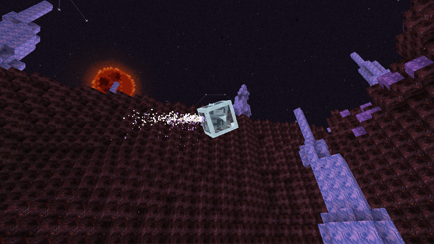 | 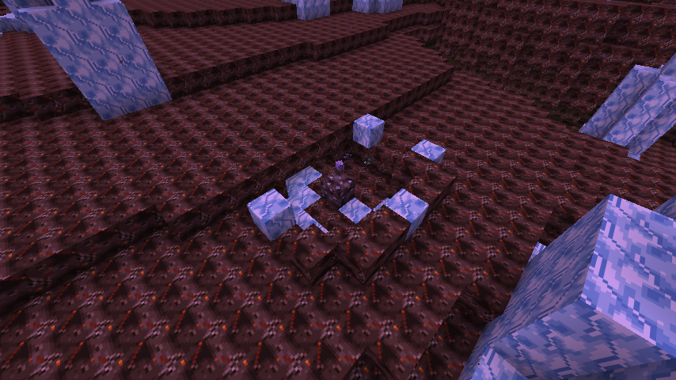 |

Now and then a **live comet** crosses the sky past you: a tumbling rock of Comet Ice and meteoric
stone inside a coma of light, shedding a long tail of sparks. It takes a minute or two to cross,
on a slow curving arc.

- **Ride the tail.** Glide through it with an elytra and it sweeps you along (a speed boost in the
  comet's direction) and you catch **Stardust Motes**, up to 16 per comet. Four motes make a
  Stardust block. Your first one earns *Catch a Falling Star*.
- **Hit the head** (like hitting a boat) to knock a chunk off: Stardust, Comet Ice, or now and
  then raw Meteoric Iron. Each comet only has six chunks to give.
- **Watch it land.** About a third of comets end their arc on an island near you: a flash, a boom
  and a **small crater**. It's a bowl ringed by a thrown-up rim, its floor glazed with Comet Ice and
  the **Comet Core** (Meteoric Iron on packed Stardust) in the middle. Stardust, Comet Ice and raw
  Meteoric Iron are scattered round it, and sometimes a **Temporal Crystal**. A landfall changes at
  most 40 blocks. It changes none if `mobGriefing` is off, or if anything nearby looks built
  (chests and other block entities, planks, glass, wool, doors, beds, rails, torches): the loot
  still drops.
- **How often:** at most one comet near a player at a time, and only beyond 1,000 blocks. About one
  every 12 minutes in the **Comet Wake**, about one an hour elsewhere in the outer End, and almost
  never in the Corona. Comets aren't saved: if you leave, the one you were chasing is gone.
- Operators can send one with `/astralend comet` (or `/astralend comet landfall`).

### Phase 6: structures

Eight structures, all built block by block in Python (`tools/structures/`) and saved as ordinary
structure templates. These are in-game screenshots taken on every build:

| Comet Crater (Comet Wake) | Whalefall (Aurora Shallows) |
|---|---|
| 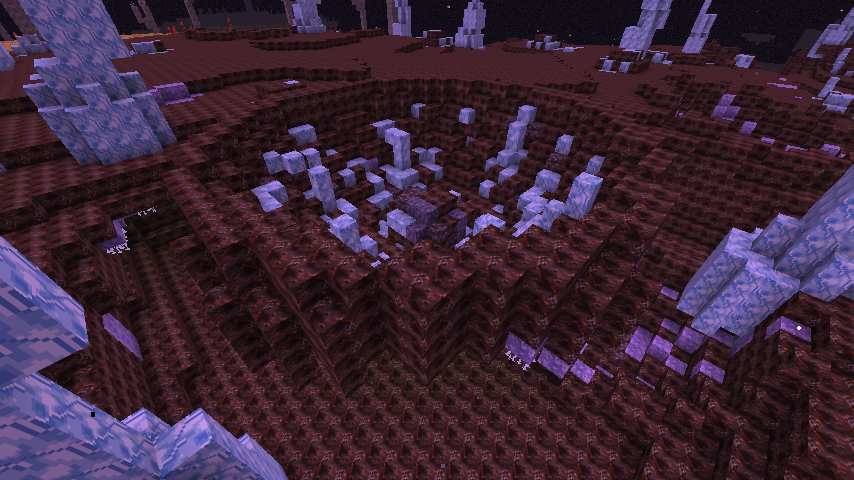 | 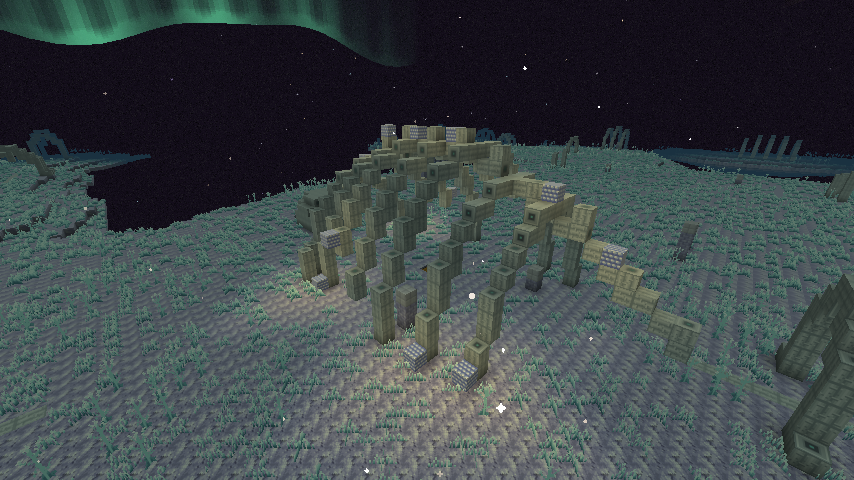 |
| **Observatory Ruins (Shattered Observatory)** | **Solar Array Ruins (the Corona)** |
| 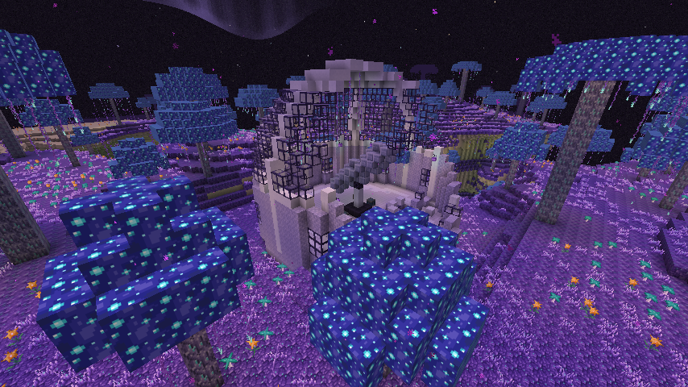 | 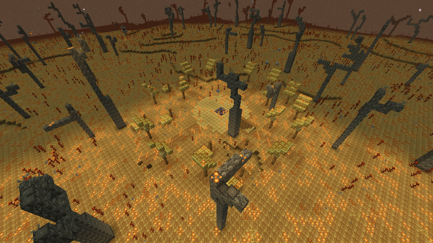 |
| **Wormhole Maw** | **Constellation Maze, its bridges lit** |
| 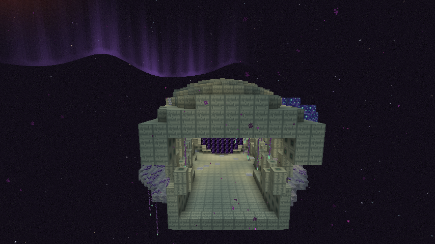 | 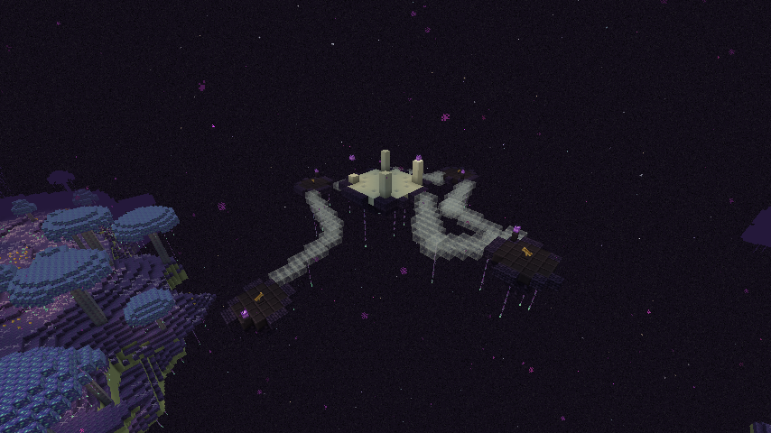 |
| **Abandoned Orrery** | **The Orrery Sentinel in its vault** |
| 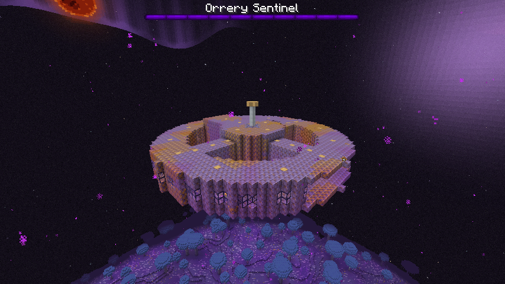 |  |

| Structure | Where | What's there |
|---|---|---|
| **Comet Crater** | Comet Wake, common | A bowl blasted into an island, ringed with thrown-up Charred End Stone, with Comet Ice shards and a Comet Core (Meteoric Iron) at the bottom and a cache buried under it. Some are still hot: magma in the floor and fires round the rim. |
| **Wanderer Relay** | Dark Matter Belt | A thin spire floating in the void with two mooring rings hung with Null Lanterns, where Void Wanderers rest. A landmark: no loot. |
| **Whalefall** | Aurora Shallows, rare | A Leviathan's fossil ribs and skull, Whalelight Scales still on the bones, and one lore chest with a Star Chart. |
| **Observatory Ruins** | Shattered Observatory, Nebula Fields | A domed hall broken open, a star map in the floor, a telescope of Meteoric Iron aimed through the gap, and two **vaults** that open for a **Chart Fragment** (like trial keys). |
| **Solar Array Ruins** | The Corona | Fields of cracked and fallen Solarite mirrors round a sunken chamber: two chests of the best loot in the End and a pedestal still holding a **Bottled Flare**. The mirrors still focus the flares: **Flare Burn is doubled on the field**. |
| **Wormhole Maw** | Shattered Observatory, Nebula Fields, Dark Matter Belt | See below. |
| **Constellation Maze** | Shattered Observatory, Nebula Fields | See below. |
| **Abandoned Orrery** | High in the sky (Y 176-200), anywhere but the Corona | See below. |

**Wormhole Maws.** The fossil skull of a Star Leviathan, jaws half open, on its own floating island.
Set a **Charged Void Crystal** in each of its four eye sockets, then use a **Portal Lens** on the dark
stone at the back of its throat: the Maw groans awake and its throat becomes a churning wormhole.
Walk in and you're sent to the next Maw you've woken, and spat out of its mouth. Each trip costs
an **ender pearl** or **four chorus fruit**. Someone who didn't wake a Maw can use a Portal Lens on its
wormhole to add it to their own road. *Portal Lens: 3 Chart Fragments, a Void Crystal, a Temporal
Crystal and a spyglass.*

**Constellation Mazes.** Platforms floating in the void round a central dais, joined by
**star-bridges you can't see**. Use the telescope on a platform: it tells you which constellation it's
aimed at and roughly where (four of them are drawn in the End's sky: the Leviathan, the Maw, the
Wanderer and the Watcher). Hold your gaze on that constellation for a moment and its bridge lights
up, solid, for 20 seconds. The last bridge leads to the dais and its chest: a Temporal Crystal and a
Star Chart that marks a Wormhole Maw. Fall, and the maze catches you and sets you back at the
start.

**Abandoned Orreries.** The Cartographers' great clockwork model of the heavens, a wheel of tarnished
**Orrery Bronze** hanging high in the sky: a ring gallery with a roost of dormant Void Wanderers, a garden
gone wild with Lumineshrooms and the keepers' quarters, joined by spokes to a hub where the cold **Orrery
Heart** sits under the orrery's axle and its gilded sun. Pour **three Bottled Flares** from the Corona
into the Heart: the lamps kindle, the vault's **Bronze Shutters** slide open for five minutes, and the
**Orrery Sentinel** wakes - a big clockwork construct with a Wanderer's lens. Up close it swings its
fists. At range a beam of focused starlight winds up for a second and a half (you see it trace toward
you) and then fires: break its line of sight before it does and it misses. It always drops a
**Starforge Template** and a **Rift Pearl**.

New blocks and items:

- **Orrery Bronze** (2 Meteoric Iron and 2 Solarite ingots make 4): the Orreries' metal, engraved with
  orbits. It tarnishes violet over time in three stages, like copper; an axe scrapes it back. (Phase 9
  gives it copper's whole family and waxing.)
- **Orrery Lamp** (Orrery Bronze round glowstone).
- **Temporal Crystal**: loot only (craters, vaults, the maze, the Orrery).
- **Star Charts** now mark structures, not just biomes. Charts found in chests are unread until you
  first use one in the End.

### Phase 5: the sky and Stellar Flares

The End has a sky of its own now. These are in-game screenshots taken on every build:

| Over the Aurora Shallows | Over the Nebula Fields |
|---|---|
| 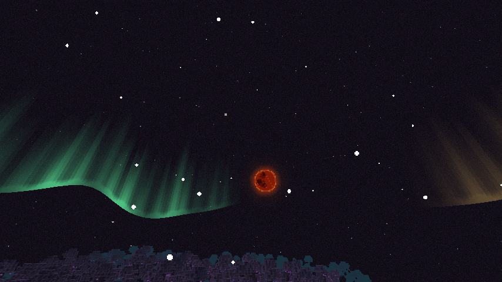 | 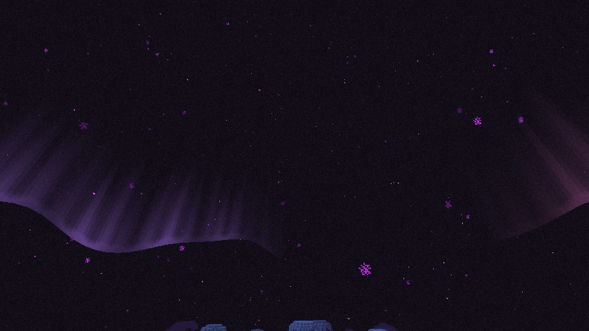 |
| **A Stellar Flare in the Corona** | **The Corona's flare blocks** |
| 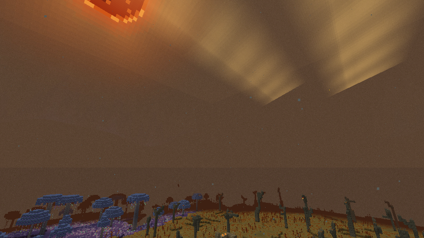 | 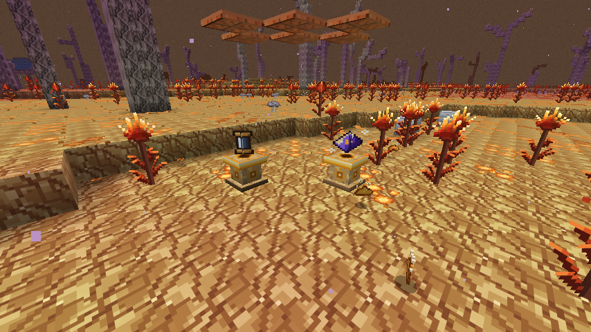 |

**The sky** (drawn in the sky renderer: no entities, nothing in the world):

- **Stars** in two layers. One layer turns, very slowly - once every 40 minutes.
- **Auroras**: slow curtains of light. Green and gold over the Aurora Shallows, a faint violet over
  the Nebula Fields, icy blue over the Comet Wake, pale over the Shattered Observatory, faintest
  in the vanilla End, none at all in the Dark Matter Belt.
- **The Remnant**, the dim, dying ember of the collapsed star, always hangs over the nearest
  Corona - low on the horizon from far away, high overhead inside it - so you can always find the
  Corona (or keep away from it). It brightens before a flare.
- Now and then a **far-off comet** streaks across the sky, and very rarely something vast - a
  whale, a ring - drifts across the far distance.

**Stellar Flares** happen every 15-25 minutes, and only the Corona feels them:

| Phase | How long | What happens in the Corona |
|---|---|---|
| **Warning** | 1 minute | The Remnant brightens and a rising tone plays; a line above the hotbar tells you to find cover |
| **Flare** | 1-2 minutes | The sky turns gold and sheets of light roll across it. **Open sky burns you (Flare Burn)**: half a heart every 3 seconds, a full heart after 30 seconds out. Flareblooms open; Skimmers take off and ride the flare; the solar wind pushes you along if you glide with an elytra |
| **Afterglow** | 2 minutes | Sunscale Lichen glows bright gold, Skimmers' wings fill up again (shear them for Skimmer Film), and **Cinder Mites swarm** out of the stone |

Anything solid over your head protects you from Flare Burn (glass too, so you can watch), and so
does a **Sunshade** or a **Potion of Flare Ward**. Armour doesn't. Everywhere else in the End, a
flare is just the Remnant blazing on the horizon.

New blocks and items:

- **Sunshade** (3 Skimmer Film over 2 Solarite Ingots, makes 4): a thin canopy that hangs at the
  top of its block space with nothing holding it up. Put one over your head and keep mining
  through a flare.
- **Collector Pedestal** (Solarite, Astral Glass, Polished Sunscorched Stone): set a **Void
  Crystal** or a **Flare Bottle** on it. Under open sky in the Corona, 30 seconds of flare charges it:
  **Charged Void Crystal** (for the Wormhole Maws of Phase 6) or a **Bottled Flare** (to power
  the Orreries). Guard it while it charges.
- **Flare Bottle** (Solarite Ingot, Astral Glass, Solarite Ingot).
- **Flare Pollen**: pick it from an open Flarebloom (use it, or break it).
- **Potion of Flare Ward**: brew an Awkward Potion with **Skimmer Film** (3:00). Brew Flare Pollen
  into it for 8:00. Splash and lingering versions brew the usual way.
- Operators can run `/astralend flare [warning|flare|afterglow|calm]` to see or set the cycle.

### Phase 4: the mobs

Eight creatures live in the astral End. Every one has its own model, animations and textures
(glowing parts shine in the dark), a spawn egg in the creative tab, and its own behaviour.
These are in-game screenshots taken on every build:

| End Pollinator | Void Wanderer | Umbral Stalker, lit by a Spore Lantern |
|---|---|---|
| 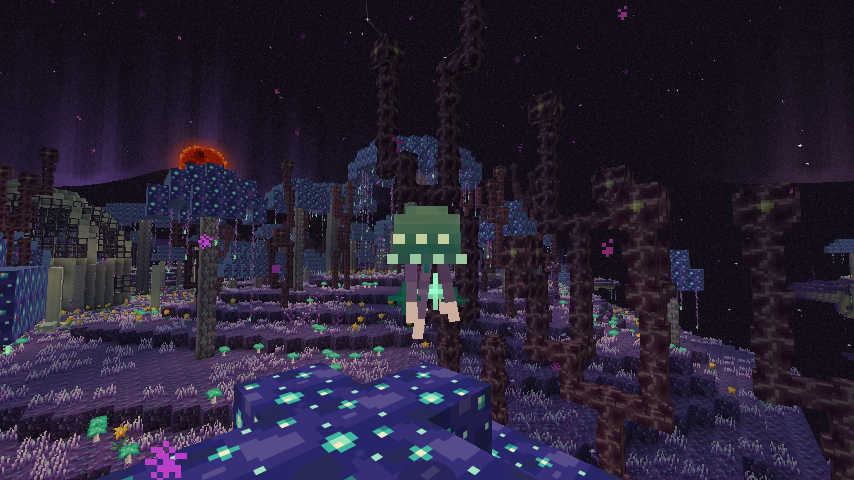 | 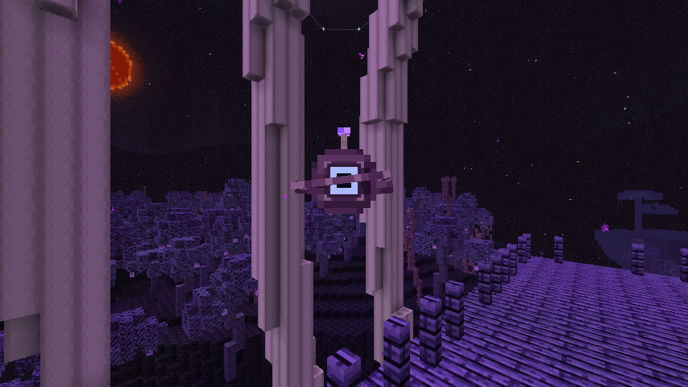 | 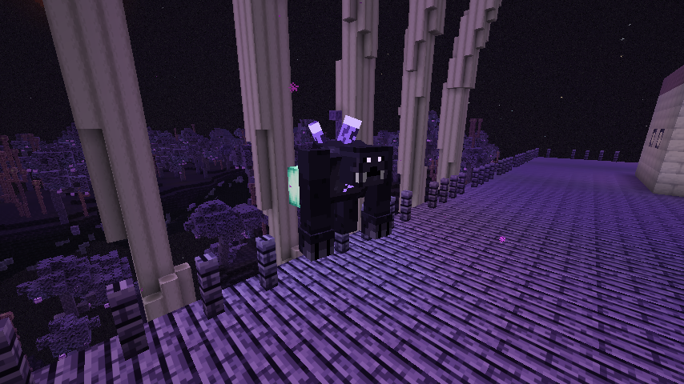 |
| **Cinder Mite** | **Corona Skimmer** | **Black Hole Guardian** |
| 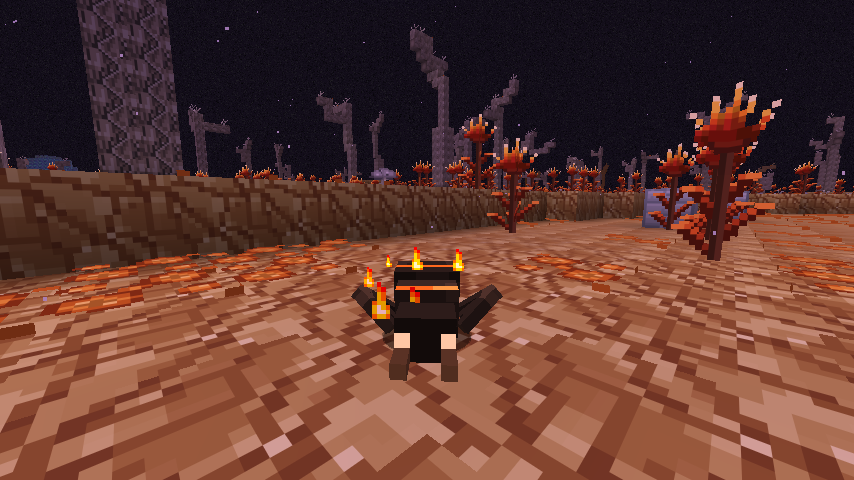 | 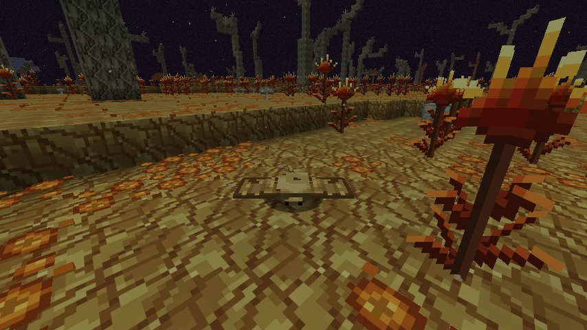 | 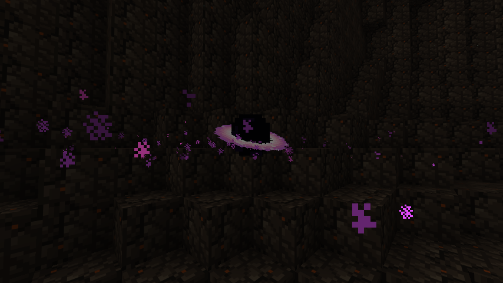 |
| **Drift Whale** | **The Watcher** | **The same Umbral Stalker, hunting in the dark** |
| 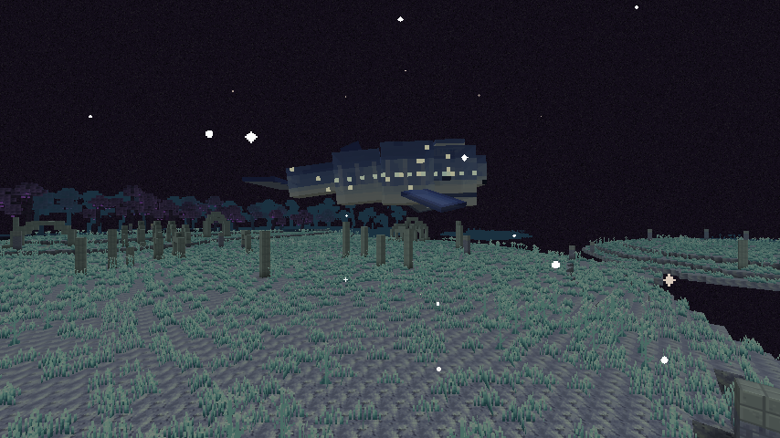 | 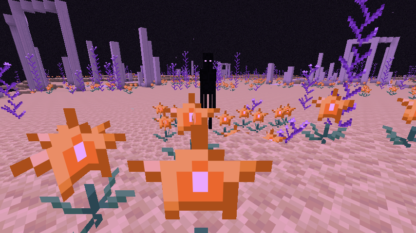 | 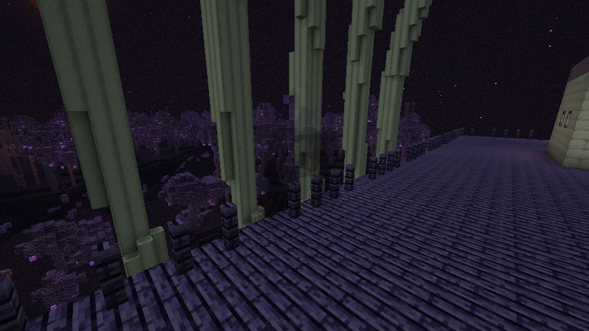 |

| Mob | Where | What it does | Leaves behind |
|---|---|---|---|
| **End Pollinator** | Nebula Fields, Aurora Shallows | A little jellyfish-like drifter. Floats between glowing plants and hovers over them; a pollinated plant spreads to the ground beside it. Starblooms tempt it and make it breed. | **Glowing Spores**, every 5-10 minutes, like a chicken lays eggs. Killing it drops nothing. |
| **Void Wanderer** | Dark Matter Belt, Shattered Observatory | A clockwork construct of the Cartographers: a verdigris bronze body with void crystal set in its seams, one great glass lens and a spinning gimbal ring. It floats over and studies you, a ring of light sweeping over you: **stand still for 5 seconds** and it leaves you a **Chart Fragment** (a shard of its star map) and drifts away. Each one studies each player once. Hit it and it looses homing starbolts back (shulker bullets) and blinks away when hurt. | Chart Fragment (for letting it chart you); its **Cracked Lens** if killed |
| **Umbral Stalker** | Dark Matter Belt (hostile) | A hunched shadow brute that walks on its knuckles, with bone tusks, dark-matter crystals growing from its back and a violet rift glowing in its chest - but in the dark you can't see it at all until it picks you as prey; then a faint shimmer shows where it moves. It creeps up **while your back is turned** and backs off when you face it. It hunts like a lion: hidden, it creeps in low and slow, then **pounces** from a few blocks behind you - a heavy ambush blow that throws you away from it, toward the void near an edge. Light reveals it (block light 7+: Null Lanterns, Spore Lanterns, torches). | **Umbral Membrane** |
| **Cinder Mite** | The Corona (hostile) | Glowing burrowers that come in swarms of about four, set you on fire, and burrow back into the stone after a minute. Immune to fire; **water kills them** in about two seconds. | **Cinder**, a fuel (smelts 4 items) |
| **Corona Skimmer** | The Corona | A flat manta that rests on the ground looking like stone, then lifts off and glides in wide circles; whole flocks ride the Stellar Flares. **Shear it** while its wings shimmer for **Skimmer Film**; the wings fill again in the next flare's afterglow. | Skimmer Film (sheared, not killed) |
| **Black Hole Guardian** | Dark Matter Belt, Comet Wake (rare, one at a time) | A small singularity that pulls you and your dropped items in. Items it swallows are **kept, not destroyed**: it drops them when it dies or collapses (after 2-3 minutes). You can only hurt it while its ring **flickers**. | **Singularity Shard**, only from a kill |
| **Drift Whale** | The void, most often over the Aurora Shallows (one at a time) | A huge translucent whale that swims slowly through the void, turns toward you and hums. Nothing can hurt it. Very rarely sheds a glowing **Whalelight Scale**. | Three advancements: *Something Big Out There*, *Whale Song*, *Tagalong* |
| **The Watcher** | Shattered Observatory (only when you're alone) | A floating sentinel of pale stone with one great eye, gold bands, glowing runes and shards circling it, at the edge of sight, there for a few seconds. Walk toward it and it's gone. **Catch it in a spyglass** and it vanishes too, leaving you a **Star Chart**. | Star Chart, and the advancement *Something Looks Back* |

New blocks and items from the mobs:

- **Spore Lantern** (4 Glowing Spores around Astral Glass): a full-brightness light block, and one
  of the lights that reveal Umbral Stalkers.
- **Whalelight Scale**: a softly glowing decoration block.
- **Glowing Spores** also grow End Stone over with Nebula Moss (use them on it), and make Glow Ink
  Sacs (2 spores + an ink sac).
- **Star Chart**: use it to see which way, and how far, the region it marks is.
- **Chart Fragment, Cracked Lens, Singularity Shard, Umbral Membrane, Skimmer Film**: materials. Chart
  Fragments open Observatory vaults and, with a Cracked Lens, make the Portal Lens; Skimmer Film makes
  Sunshades and Flare Ward; Singularity Shards and Umbral Membranes are Starforge materials.

(Since Phase 5, Cinder Mite swarms and Skimmer flocks follow the Stellar Flares.)

### Phase 3.5: each biome is its own world

The astral biomes are now **territories a few thousand blocks across**, each built on its **own
large islands** with its own shape, ground cover and giant flora, so arriving at one feels like
landing somewhere new. These are real in-game screenshots, taken automatically on every build:

| Nebula Fields | Dark Matter Belt |
|---|---|
| 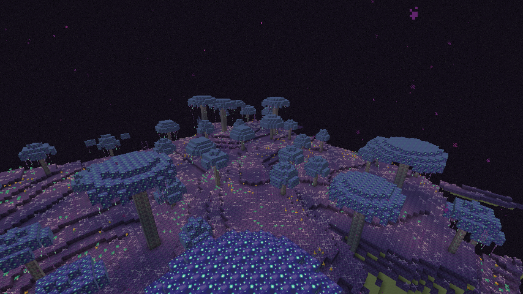 | 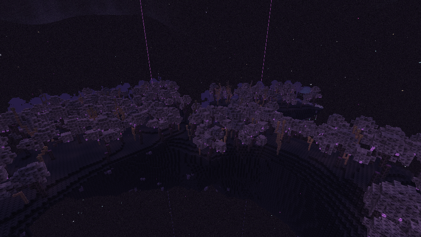 |
| **Aurora Shallows** | **Comet Wake** |
| 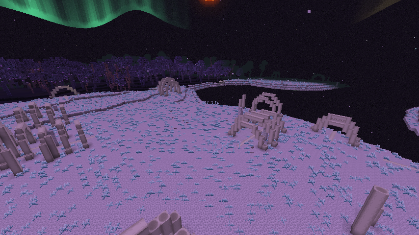 | 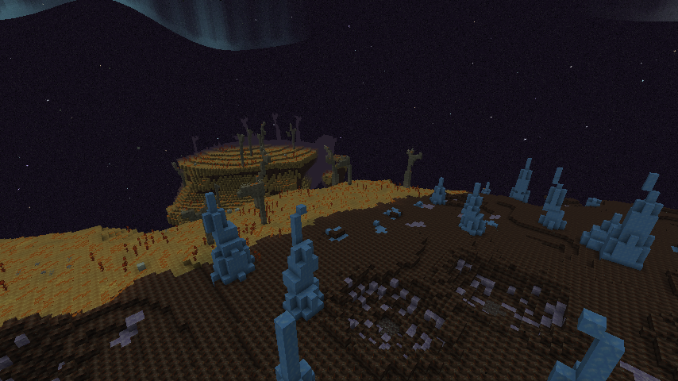 |
| **The Corona** | **Shattered Observatory** |
| 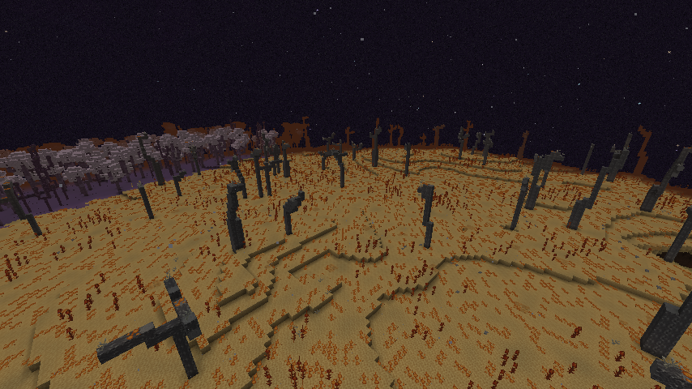 | 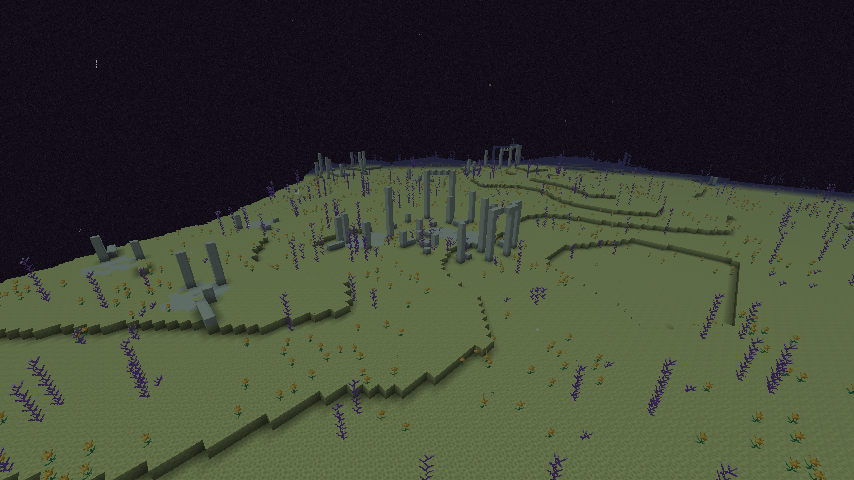 |

- **Nebula Fields:** rolling moss islands under forests of **giant Lumineshrooms** (glowing caps in
  three sizes, the biggest on thick 2x2 stems), a carpet of **Nebula Tufts**, and glowing **Nebula
  Tendrils** dripping from mushroom caps and island undersides.
- **Dark Matter Belt:** ring-shaped archipelagos under dense, dim forests of twisted **Nullwood**
  trees, lit only by the glowing **Null Lanterns** hanging from their leaves.
- **Aurora Shallows:** vast flat shelves with meadows of Shimmer Grass and tall **Shimmer Reeds**,
  and whole **Leviathan ribcages** (a spine with rib arches over it) lying on the ground.
- **Comet Wake:** scorched islands pocked with **impact craters** (Meteoric Iron at the bottom of
  each) and **Comet Ice spires** driven into the ground at an angle.
- **The Corona:** flat-topped mesas with sheer cliffs, glowing lichen and Flarebloom fields, and
  the crooked **petrified stalks** of giant vines that died there.
- **Shattered Observatory:** a large island with **great rings** of quartz pillars and lintels
  around star mosaics, mostly fallen, in a garden of Starblooms and Astral Vines.

**Two new wood types**, each a full set (log, wood, stripped versions, planks, stairs, slab,
fence, fence gate, door, trapdoor, button, pressure plate) that crafts exactly like vanilla wood:

- **Lumine** wood, from the stems of giant Lumineshrooms (like the Nether's crimson and warped
  "wood" from huge fungi): pale lilac with cyan glints. **Lumine Cap** blocks glow (light 12).
- **Nullwood**, from the Dark Matter Belt's trees: black bark, deep violet heartwood. Its leaves
  drop **Nullwood Saplings**, which grow on End ground. **Null Lanterns**, the trees' glowing fruit,
  give off light like a Shroomlight and hang under leaves or logs.

Strip logs with an axe as usual. End wood doesn't burn, like Nether wood. Also new: **Nebula
Tufts**, **Nebula Tendrils** (climbable, glowing tips), **Shimmer Reeds** and **Petrified Stalks**.

**"Worlds using Experimental Settings are not supported":** Minecraft shows this once when you
create (or first open) a world with this mod, because the mod changes how the End generates. It's
normal for any mod or datapack that changes a dimension; click **I Know What I'm Doing!** and it
won't ask again for that world.


### Phase 3: the other five biomes

Beyond about 1,000 blocks from the dragon's island, the outer End is now a patchwork of the
vanilla biomes and **six astral biomes**, each in regions several hundred blocks across. Every
biome has its own stone, and the terrain itself changes shape in three of them.

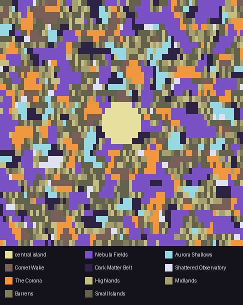

| Biome | Share of the outer End | What you find there |
|---|---|---|
| **Nebula Fields** (Phase 2) | ~23% | Nebula Moss, Lumineshrooms, Starblooms, Astral Vines, low gravity |
| **Aurora Shallows** | ~6% | Wide, **flat-topped shelves** of **Pale End Stone** (all level at y=54, thinning to see-through edges), **Shimmer Grass**, standing stones, and ribs of **Leviathan Bone** sticking out of the ground |
| **Comet Wake** | ~7% | **Charred End Stone** islands with small floating debris between them, **Stardust** veins, glassy **Comet Ice**, **Comet Cores** (boulders with a heart of **Meteoric Iron Ore**), and Stardust stuck under islands with **Comet Cress** hanging from it |
| **Dark Matter Belt** | ~9% | Ragged, **ring-shaped** islands of **Umbral Stone** (big islands are hollow in the middle), **Void Crystal Ore**, dark violet fog, and **Gravity Inversion Pockets** |
| **The Corona** | ~11% | A crust of **Sunscorched Stone** over Charred End Stone, **Solarite Ore** (rich at the surface, sparse deeper in), **Flareblooms**, glowing **Sunscale Lichen**, and the dead: **Ashen Lumineshrooms**, **Petrified Astral Vines**, **Pollinator Husks** |
| **Shattered Observatory** | ~2% (rare) | Ruins of **Observatory Quartz** set into the islands: round floors with a **Star Inlay** at the centre, broken and fallen pillars, overgrown with Starblooms and Astral Vines; now and then a great ring of standing pillars with a mosaic floor |

What the survey found in each biome, seen from above (dimmed = just outside the biome):

| Aurora Shallows | Comet Wake | Dark Matter Belt |
|---|---|---|
|  | 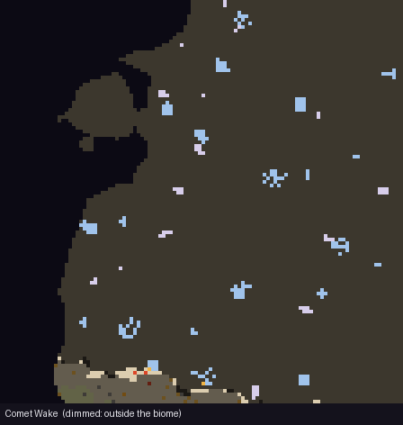 |  |
| **The Corona** | **Shattered Observatory** | **Nebula Fields** |
| 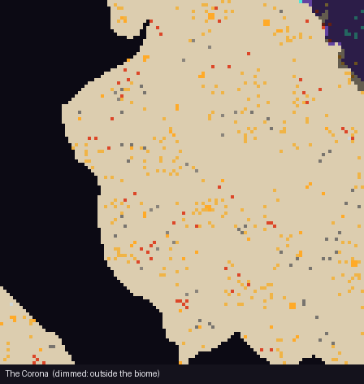 | 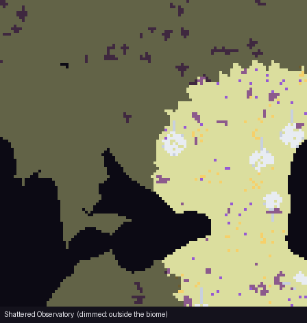 | 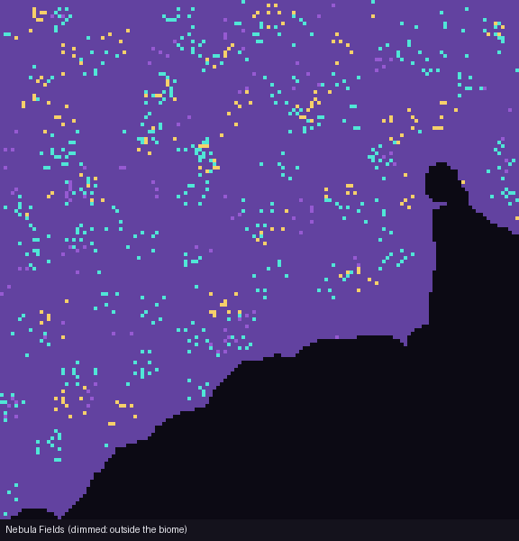 |

**Gravity Inversion Pockets** (Dark Matter Belt): a **Gravity Anomaly** (a swirling black
block) is set into the underside of an island, with a sphere of flipped gravity about 11 blocks
across hanging below it, marked by rising purple motes. Walk into one and you fall *upward* onto
the island above; step out and normal gravity returns. It works on mobs too. The island is
always above the pocket, so you never fall up into the void. To turn pockets off, add a datapack
with an empty `data/astralend/tags/worldgen/biome/upwells.json`:
`{"replace": true, "values": []}`.

The Corona is safe for now: the Remnant and its Stellar Flares arrive in Phase 5. The mobs
(and their spawn eggs) come in Phase 4.

**New blocks and items** (all in the **The Astral End** creative tab):

| Content | What it does |
|---|---|
| **Pale End Stone** (+ Bricks, Tiles, stairs, slabs, walls) | Bleached End Stone from the Aurora Shallows. Crafts and stonecuts like End Stone Bricks. |
| **Shimmer Grass** | Short pale grass. Drops only with shears, like grass. |
| **Charred End Stone** (+ stairs, slab, wall) | Comet-scorched End Stone. Also made by smelting End Stone. |
| **Comet Ice** | Never melts; as slippery as blue ice. Needs Silk Touch. |
| **Sunscorched Stone** (+ Polished, Bricks, stairs, slabs, walls) | The Corona's bleached, cracked stone. |
| **Solarite Ore** → **Raw Solarite** → **Solarite Ingot** | Corona only. Needs a diamond pickaxe; Fortune works. Smelt or blast the raw metal. The ore glows faintly. Blocks of Solarite glow and work in beacon bases. |
| **Flarebloom** | A two-block-tall flower, shut tight (it opens during flares, in Phase 5). Makes orange dye. |
| **Sunscale Lichen** | A glowing (light level 5) scaly ground cover, placed like a carpet. |
| **Ashen Lumineshroom**, **Petrified Astral Vine** | The grey, lifeless remains of Nebula Fields plants that tried to grow in the Corona. |
| **Pollinator Husk** | A bleached, fossil-like shell. Decoration; rotates like a log. |
| **Observatory Quartz** (+ Pillar, Star Inlay, stairs, slab, wall) | The ruins' cut stone. Stonecuts into the pillar and the inlay. |
| **Gravity Anomaly** | The core of an inversion pocket. Very hard to break; needs Silk Touch and a diamond pickaxe. Placed anywhere in a Dark Matter Belt, it makes a new pocket below itself. |

### Fixes in Phase 3

- **Spectator mode** works like vanilla again: no block texture covering your screen when you fly
  into a block. This was a bug in Forge 66.0.8 itself (its change to the renderer skipped
  vanilla's "not for spectators" check), not something the mod did, but the mod now works around it.
- **Getting to the End from a stronghold** works. The automatic survey steps through a real End
  Portal on every build and checks you arrive on the obsidian platform at (100, 50, 0) with the
  dragon fight set up. Note that in vanilla Minecraft **spectators can't use portals** (they
  don't touch blocks, so a portal never triggers); switch to survival or creative first.
- The mod's blocks now count as solid for Minecraft 26.3, which decides that with block tags
  (`#minecraft:blocks_motion_no_leaves`). Before, Nebula Moss was treated like air by the game's
  height maps, so fewer plants grew on it.

### Phase 2: the Nebula Fields biome

The first astral biome: **Nebula Fields**, regions several hundred blocks across covering
about a fifth of the outer End.

- **Islands are topped with Nebula Moss** and scattered with glowing **Lumineshrooms**,
  **Starblooms** and upward-growing **Astral Vines**. No chorus grows there.
- **Violet fog** and slowly drifting purple motes.
- **Low gravity:** you (and mobs) fall about a third slower and jump about 1.5x higher, and
  can fall 3 more blocks before taking damage. Ender pearls thrown there fly about 20% further.
  It switches on and off within a second of crossing the biome border.
- Endermen spawn as usual, and return End Gateways can still appear.
- Everything within 1,000 blocks of the centre, the dragon fight and End Cities are unchanged.

All the pictures come from a real world generated by the automatic survey (see section 6).

**To find any astral biome:** start a **new world**, or explore parts of the End you haven't
visited yet (areas already generated stay as they were). Go to the End, then use an End Gateway
or fly outward. In creative, `/locate biome astralend:nebula_fields` (or `ashen_barrens`,
`comet_wake`, `hollow_isles`, `shattered_observatory`, `corona`) gives the nearest one, and
the F3 screen shows the biome you're in.

**To turn low gravity off** (for a server, say), add a datapack with an empty
`data/astralend/tags/worldgen/biome/low_gravity.json`: `{"replace": true, "values": []}`.

### Phase 1: blocks, materials and plants

Everything is in the **The Astral End** tab of the creative inventory, and all of it now
generates in the End: Umbral Stone and Void Crystal Ore in the Dark Matter Belt, Stardust,
Meteoric Iron and Comet Cress in the Comet Wake, Leviathan Bone in the Aurora Shallows.


| Content | What it does |
|---|---|
| **Umbral Stone** (+ Polished, Bricks, Chiseled, and stairs, slabs and walls) | The dark stone of the Dark Matter Belts. Crafts and stonecuts like deepslate. |
| **Void Crystal Ore** → **Void Crystal** | Mine with an iron pickaxe. Drops a gem like diamond ore, works with Fortune and Silk Touch. 9 make a block. |
| **Meteoric Iron Ore** → **Raw Meteoric Iron** → **Meteoric Iron Ingot** | Needs a diamond pickaxe. Smelt or blast the raw metal. Nuggets and blocks craft like iron. |
| **Stardust** | Sand that **falls up**: it drifts upward until it hits something. Smelts into **Astral Glass**. |
| **Astral Glass** | Dark glass with stars caught in it. Needs Silk Touch to pick up, like glass. |
| **Leviathan Bone Block** | Fossil bone, placed like logs or bone blocks (it rotates to the face you click). |
| **Nebula Moss** | Soft violet ground cover; Lumineshrooms and Starblooms grow on it. |
| **Lumineshroom** | A glowing mushroom (light level 10) whose cap slowly "breathes". Grows on Nebula Moss, End Stone or Umbral Stone. |
| **Starbloom** | A star-shaped flower. Grows on grass, End Stone or Nebula Moss. Makes yellow dye, and Night Vision suspicious stew. |
| **Astral Vine** | Grows upward like twisting vines, and you can climb it. Bone meal makes it grow. |
| **Comet Cress** | A food crop that **hangs from the underside of Stardust** and grows downward. Doesn't need light. Plant the cress itself, like carrots. |

## Quick start: one command for everything

After the one-time setup below (Java 25 plus this project on your computer), everything runs from a
terminal inside this folder with `./dev.sh`:

| Command | What it does |
|---|---|
| `./dev.sh` | Launch Minecraft with your mod (same as `./dev.sh run`) |
| `./dev.sh build` | Build your mod jar into `build/libs/` |
| `./dev.sh source` | Unpack Minecraft's source code, textures and data into `~/minecraft-source` |
| `./dev.sh crash` | Show the start of the newest crash report, to paste when asking for help |
| `./dev.sh repair` | Fix a broken first-time download (errors like `Unexpected end of ZLIB input stream`) |

`dev.sh` finds Java 25 by itself on a Mac, even if another Java is your default.
The very first command downloads and sets up Minecraft, which takes 5–15 minutes. After that, launching
takes under a minute.

## 1. Install the tools (one time)

| Tool | Why | Get it |
|---|---|---|
| **JDK 25** | Minecraft 26.x runs on Java 25 | [Adoptium Temurin 25](https://adoptium.net/temurin/releases/?version=25). On a Mac, pick **aarch64** (Apple Silicon) or **x64** (Intel) and download the **.pkg** installer, not the .tar.gz |
| **An editor** | IntelliJ IDEA Community has the best Gradle support; VS Code or Antigravity also work (see section 3) | [jetbrains.com/idea](https://www.jetbrains.com/idea/download/) |
| **Minecraft Java Edition** | To play your mod for real (not needed for `runClient`) | minecraft.net |
| **Git** (optional) | Version control | git-scm.com |

You do **not** install Gradle yourself. The `gradlew` script in this folder downloads the right version.

## 2. Get this project

```
git clone https://github.com/ggrantrichards/minecraft-forge-mod.git
cd minecraft-forge-mod
./dev.sh build
```

The repository is private: if Git asks for a password, use a GitHub personal access token
(github.com/settings/tokens, with the **repo** box ticked), not your GitHub password.

To start a different mod from scratch instead, download the **MDK** (Mod Development Kit) for your
Minecraft version from <https://files.minecraftforge.net/> and unzip it. This project is that MDK
plus the example content.

## 3. Open it in IntelliJ, which also gets you the Minecraft source

1. IntelliJ → **Open** → select this folder (the one with `build.gradle`) → *Trust project*.
2. Wait for the Gradle sync. **The first sync takes 5–15 minutes.** ForgeGradle downloads
   Minecraft, applies Forge's patches, and **decompiles Minecraft into readable Java source**.
3. When it finishes, you have the Minecraft source code:
   - Press **Shift Shift** (Search Everywhere) and type a class name such as `Block`, `Item`,
     `Player`, `Zombie`, or `Blocks`, then open it.
   - Or **Ctrl+click** (Cmd+click on Mac) any Minecraft class in `AstralEnd.java`.
   - In the Project panel, look under **External Libraries** for the Minecraft/Forge jar.
   If IntelliJ shows a "decompiled .class file" banner, that's fine; it's still readable Java.
   Since 26.1, Mojang ships Minecraft **unobfuscated**, so you see the real names Mojang's
   developers use.
   Reading vanilla code is the most important modding skill: to make something like a
   vanilla thing, find the vanilla thing and copy its approach.

   > You may read and learn from the decompiled code, but you may not redistribute
   > Minecraft's code. Your mod jar contains only *your* code.

To browse **all** of Minecraft as ordinary files instead, run `./dev.sh source`. It unpacks
everything into `~/minecraft-source`: Java code in `net/minecraft/`, textures and models in
`assets/minecraft/`, and recipes, loot tables and tags in `data/minecraft/`. Add that folder to
your editor (**File → Add Folder to Workspace**), then use **Cmd+P** / **Ctrl+P** to open a file
by name (`Zombie.java`, `Blocks.java`, `iron_ore.json`) and **Cmd+Shift+F** / **Ctrl+Shift+F** to
search everything. Treat it as read-only reference and never commit or upload it.

From a terminal instead: `./gradlew build` (Windows: `gradlew.bat build`).

### Using VS Code or Antigravity instead of IntelliJ

1. Install the extensions **Extension Pack for Java** (or at least **Language Support for
   Java by Red Hat**) and **Gradle for Java**. In Antigravity, search for them in its
   extensions panel.
2. **File → Open Folder** → this folder. Say yes to importing the Gradle project, then wait
   for the Java status in the bottom bar to say it's ready. The first import takes 5–15 minutes.
3. To read Minecraft's source, press **Ctrl+T** (Cmd+T on Mac) and type a class name such as
   `Block`, or Ctrl+click a Minecraft class in `AstralEnd.java`. Or run `./dev.sh source` and add
   `~/minecraft-source` to the workspace (see above). If a class opens with no code inside, set
   the `java.contentProvider.preferred` setting to `fernflower`.
4. Run everything from the built-in terminal (**Ctrl+`**): `./gradlew runClient`, or
   `.\gradlew.bat runClient` on Windows.

### Checking your Java

Run these in a terminal. You need a **JDK** (it includes `javac`), not only a Java runtime.

```
java -version        # should say 25
javac -version       # should say javac 25 (if "not found", you only have a runtime, not a JDK)
```

Then, inside this folder, ask Gradle which JDKs it can see:

```
./gradlew -q javaToolchains       # Windows: .\gradlew.bat -q javaToolchains
```

The first time you run a Gradle command here, Forge also sets up Minecraft, so it can take several
minutes. If `gradlew` itself fails with a Java version error, your default `java` is older than 17;
set `JAVA_HOME` to your Java 25 folder.

If that lists a JDK with **Language Version: 25** and **Is JDK: true**, you're set. If not, Gradle downloads one
automatically on the first build.

## 4. Run the game with your mod

- In IntelliJ's Gradle panel (elephant icon, right side): open **astralend → Tasks**, find **runClient**, and double-click it, or
- in a terminal: `./dev.sh` (or `./gradlew runClient`)

A development copy of Minecraft opens with your mod loaded, and you can use it offline.
Make a Creative world, then:
- open the creative inventory and click the **The Astral End** tab (the Void Crystal icon), or
- `/give @s astralend:stardust_block 16`, then place it under a ceiling and watch it rise;
- place Stardust against a ceiling and plant **Comet Cress** on its underside.

Game files for this dev copy (worlds, logs, options) go in `run/`. The full log is
`run/logs/latest.log`; crash reports are in `run/crash-reports/` (`./dev.sh crash` shows the newest).

On a Mac, the client runs with `-XstartOnFirstThread` (set in `build.gradle`). The normal
Minecraft launcher adds this for Mac players; without it the game fails with
"Unable to initialize SDL: No available video device".

## 5. How the project is laid out

```
build.gradle                  Minecraft + Forge versions, run configs
settings.gradle               project name
src/main/java/com/ggrantrichards/astralend/
  AstralEnd.java              entry point (@Mod)
  ModBlocks.java              every block (and its block item)
  ModItems.java               items that aren't blocks
  ModCreativeTabs.java        "The Astral End" creative tab (lists everything automatically)
  ModBlockEntities.java       blocks that run code every tick (the Gravity Anomaly)
  block/                      blocks with custom behaviour (Stardust, plants, crops, Gravity Anomaly)
  entity/                     the mobs: what each one does, its AI and its spawn rules
  item/                       items with custom behaviour (Glowing Spores, Star Chart)
  world/                      the End biome source and its regions, biome keys, low gravity,
                              gravity inversion, the one-at-a-time mob spawner, advancements
  world/feature/              world generation features written in Java (comet cores, ruins...)
  client/                     client-only code (the spectator-mode fix, CI screenshots)
  client/entity/              the mobs' renderers and animations
  client/model/MobMeshes.java the mobs' model geometry (generated by tools/mobs/make_mobs.py)
  dev/WorldgenSurvey.java     test tool: maps and samples the generated End (CI only)
src/main/resources/
  META-INF/mods.toml          mod ID, name, version, dependencies
  pack.mcmeta                 required: makes Minecraft load assets/ and data/ below
  assets/astralend/           CLIENT stuff: what things look like
    textures/block/*.png          16x16 PNGs (drawn by tools/textures/make_textures.py)
    textures/item/*.png
    textures/entity/<mob>/*.png   mob skins, plus a _glow.png for the parts that shine
    models/block/*.json           e.g. "cube with the same texture on all sides"
    models/item/*.json            e.g. "flat item using this texture"
    items/*.json                  which model to use for each item
    blockstates/*.json            which model to use for each block state
    lang/en_us.json               display names
  data/                       SERVER stuff: game rules
    astralend/recipe/*.json       crafting recipes
    astralend/loot_table/blocks/  what a block drops
    astralend/loot_table/entities/  what a mob drops
    astralend/advancement/end/    the mobs' advancements (Drift Whale, the Watcher)
    minecraft/tags/block/...      "mineable with pickaxe", "needs iron tool"
    astralend/worldgen/           the six astral biomes, their features, the End's terrain
                                  (density functions), noise settings and surface ("material") rule
    minecraft/dimension/the_end.json  plugs our biome source into the End
tools/
  textures/make_textures.py   draws every texture, plus docs/images/textures.png
  textures/pixelart.py        pixel-art building blocks (noise, ramps, lit cells, ores, leaves)
  textures/hq.py              the textures themselves, drawn with those building blocks
  mobs/make_mobs.py           each mob's model and its textures, from one description
  mobs/preview_mobs.py        renders the mob models to docs/images/mob_models.png
  generate_resources.py       writes all the JSON above from one list
  check_resources.py          checks nothing is missing (run before launching)
  render_survey.py            turns the survey's maps into the pictures in this README
docs/END_UPDATE.md            the full plan for the mod
```

Rule of thumb: **Java registers that a thing exists and what it does. JSON says what it
looks like, what it's called, how it's crafted, and what it drops.**
Everything uses IDs like `astralend:void_crystal`, where the namespace is your mod ID.

## 6. Adding a new block or item

The JSON files are generated, so you rarely write them by hand:

1. **Java:** register it in `ModBlocks.java` (a block, which also gets an item) or
   `ModItems.java` (an item only). Copy a similar line, like `CHORUS_MOSS` or `VOID_CRYSTAL`.
   It appears in the **The Astral End** creative tab automatically (the tab lists every block
   and item the mod registers, in the order they're declared).
2. **Texture:** add a function to `tools/textures/hq.py` and list it in `TEXTURES` at the bottom
   (or save a 16×16 PNG into `src/main/resources/assets/astralend/textures/block/` or `item/`
   using Aseprite, Piskel or LibreSprite), then run `python3 tools/textures/make_textures.py`.
   Follow the texture rules below.
3. **JSON:** add it to the right list at the top of `tools/generate_resources.py`, then run
   `python3 tools/generate_resources.py`. That writes its blockstate, models, item
   definition, loot table, tags and English name.
4. **Check:** `python3 tools/check_resources.py`. It says exactly what's missing, if anything.
5. `./dev.sh` to see it in game.

The scripts need Python 3 and Pillow (`pip3 install pillow`).

### Texture rules (every texture, in every phase)

Textures must hold up next to vanilla Minecraft's. `tools/textures/pixelart.py` has the
building blocks for this; `hq.py` shows them in use.

- **No per-pixel random noise.** Use smooth, tileable noise quantized to a colour ramp
  (`rock()`, `quantize()`), so tones form patches the way vanilla stone and sand do.
- **Short, hue-shifted ramps:** 4-6 tones from `ramp()`: shadows cooler, highlights warmer.
- **Light from the top-left.** Lumps, plates, bricks, leaves and nuggets get a lighter top/left
  edge and a darker bottom/right (`chunks()`, `cell_light()`, `shadow_below()`, `ore()`).
- **Deliberate details:** ore nuggets, pits, cracks and glints go in hand-picked places, a few
  of each; plants are drawn blade by blade or petal by petal, not stamped from noise.
- **Check it in a scene, not just as a square.** `python3 tools/textures/scene.py` draws blocks
  in little scenes (a giant mushroom on moss, the Corona's ground), up close and from a distance
  (`docs/images/texture_scenes.png`). A colour or pattern that looks fine in one square can look
  like mould or a grid across a hillside.
- **Mobs follow vanilla's design language:** chunky, symmetric, mostly axis-aligned boxes (use
  inflated overlay boxes and flat planes for detail, like the Illager's robe and the Warden's
  tendrils); mostly flat colour fields with 3-4 tones; a few strong focal features (a readable
  face, a trim, a glowing pattern). Compare against vanilla mobs of a similar role before drawing.
- **Check it tiled and in the world.** `make_textures.py` writes `docs/images/textures.png`
  and `docs/images/textures_tiled.png` (3×3 tiling shows seams and repetition). A texture that
  covers the ground must stay calm from a distance: high-contrast lines or bright dots turn into
  a grid.
- **Mobs** are described once in `tools/mobs/make_mobs.py` (model boxes and how to paint each
  face). Use the smooth noise `n()` for skin, not random pixels.
  `python3 tools/mobs/preview_mobs.py` renders the models from three angles
  (`docs/images/mob_models.png`) without starting the game. The CI screenshots are the final
  check.

If something shows as a **purple/black checkerboard**, a model or texture path is wrong
(`check_resources.py` finds these). If it shows as **`block.astralend.something`**, its English
name is missing. If **all** your textures, names and recipes are missing and the game warns
"failed to load a valid ResourcePackInfo", `src/main/resources/pack.mcmeta` is missing or broken.

**Automatic checks:** every push to GitHub builds the mod, loads it in a server (checking
recipes, loot tables and tags), **surveys a freshly generated End**, boots the real game
client (failing if any model or texture is missing), and then **opens the surveyed world in the
real client and photographs every biome and every mob** (`client/ClientScreenshots.java`); the pictures are
published to the repository's `ci-screenshots` branch. The survey travels through a real End
Portal and checks the arrival platform and dragon fight, maps the End's biomes and how much each
covers, generates an area of every astral biome and checks it has its stone, ores, plants and
features, tests low gravity and gravity inversion, and spawns every mob in its home biome and
runs it for a moment. Results are on the repository's
**Actions** tab. To run the survey yourself: `./gradlew runServer -PastralendSurvey` (it prints
a report to the log and stops); `python3 tools/render_survey.py run/logs/latest.log` then turns
its maps into the pictures above.

## 7. Build a jar and play it in real Minecraft

1. `./gradlew build` → your mod is `build/libs/astralend-1.0.0-beta.1.jar`.
2. Install Forge for 26.3 in your normal launcher: download the **Installer** from
   files.minecraftforge.net, run it, and choose *Install client*.
3. Put the jar in your `.minecraft/mods/` folder.
   - Windows: `%APPDATA%\.minecraft\mods`
   - macOS: `~/Library/Application Support/minecraft/mods`
   - Linux: `~/.minecraft/mods`
4. Pick the **forge** profile in the Minecraft Launcher → Play.

## 8. Renaming the mod

The mod ID `astralend` appears in `AstralEnd.MODID`, `mods.toml` (twice, including
`[[dependencies.astralend]]`), `build.gradle` (the runs), `settings.gradle`, and the
`assets/astralend` and `data/astralend` folder names and every `astralend:` inside the JSON.
Rename the Java package `com.ggrantrichards.astralend` with IntelliJ's Refactor → Rename.

## 9. Where to go next

- Forge docs: <https://docs.minecraftforge.net/>
- Official MDK examples (Mixins, Access Transformers, and more): <https://github.com/MinecraftForge/MDKExamples>
- Forge source: <https://github.com/MinecraftForge/MinecraftForge> (the `26.3` branch)
- Forge Discord and the forums at forums.minecraftforge.net
- What's next for this mod: Phase 4, the mobs (with spawn eggs in the creative tab). See the
  roadmap in [docs/END_UPDATE.md](docs/END_UPDATE.md).

## Updating to a newer Minecraft version

Change `net.minecraftforge:forge:26.3-66.0.8` in `build.gradle` and the version ranges in
`mods.toml`, then re-sync. Also update `max_format` in `pack.mcmeta` to the new version's pack
formats (listed under `pack_version` in `version.json` inside `~/minecraft-source` after `./dev.sh source`). Minecraft changes its code every version, so expect some fixes.
Forge's changelog and the MDK for the new version show what changed.
