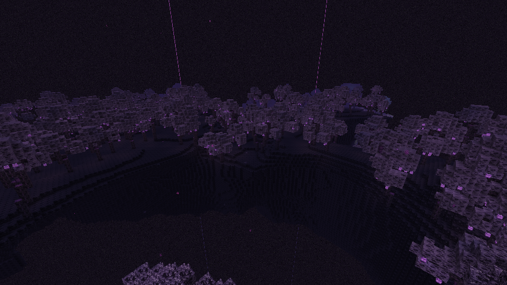
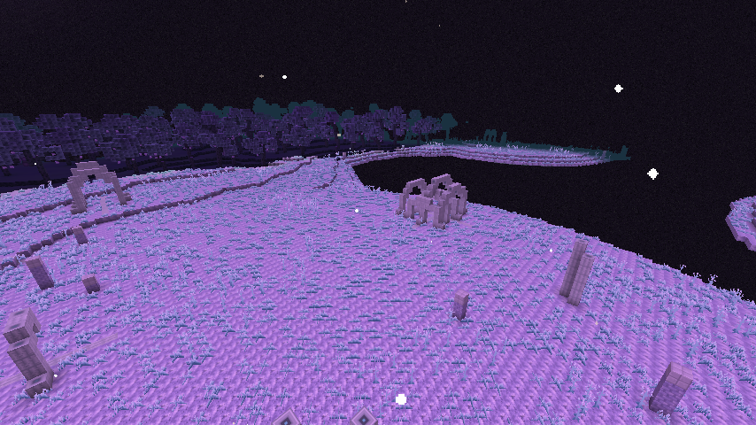
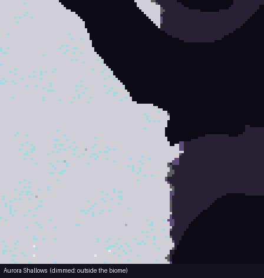
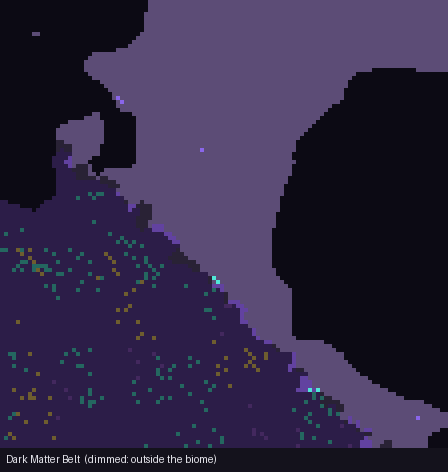

# The Astral End

A Forge mod for **Minecraft Java Edition 26.3** with **Forge 66.0.8** that expands the End
into a sparse, mysterious network of astral islands. The full plan is in
[docs/END_UPDATE.md](docs/END_UPDATE.md).

**Status:** Phase 3.5 of 9 (every astral biome is now a world of its own). Mod ID: `astralend`.

## What's in the mod so far

### Phase 3.5: each biome is its own world

The astral biomes are now **territories a few thousand blocks across**, each built on its **own
large islands** with its own shape, ground cover and giant flora, so arriving at one feels like
landing somewhere new. These are real in-game screenshots, taken automatically on every build:

| Nebula Fields | Dark Matter Belt |
|---|---|
|  |  |
| **Aurora Shallows** | **Comet Wake** |
|  |  |
| **The Corona** | **Shattered Observatory** |
|  |  |

- **Nebula Fields:** rolling moss islands under forests of **giant Lumineshrooms** (glowing caps in
  three sizes, the biggest on thick 2x2 stems), a carpet of **Nebula Tufts**, and glowing **Nebula
  Tendrils** dripping from mushroom caps and island undersides.
- **Dark Matter Belt:** ring-shaped archipelagos under dense, dim forests of twisted **Nullwood**
  trees, lit only by the glowing **Null Lanterns** hanging from their leaves.
- **Aurora Shallows:** vast flat shelves with meadows of Shimmer Grass and tall **Shimmer Reeds**,
  and whole **Leviathan ribcages** (a spine with rib arches over it) lying on the ground.
- **Comet Wake:** scorched islands pocked with **impact craters** (Meteoric Iron at the bottom of
  each) and **Comet Ice spires** driven into the ground at an angle.
- **The Corona:** flat-topped mesas with sheer cliffs, glowing lichen and Flarebloom fields, and
  the crooked **petrified stalks** of giant vines that died there.
- **Shattered Observatory:** a large island with **great rings** of quartz pillars and lintels
  around star mosaics, mostly fallen, in a garden of Starblooms and Astral Vines.

**Two new wood types**, each a full set (log, wood, stripped versions, planks, stairs, slab,
fence, fence gate, door, trapdoor, button, pressure plate) that crafts exactly like vanilla wood:

- **Lumine** wood, from the stems of giant Lumineshrooms (like the Nether's crimson and warped
  "wood" from huge fungi): pale lilac with cyan glints. **Lumine Cap** blocks glow (light 12).
- **Nullwood**, from the Dark Matter Belt's trees: black bark, deep violet heartwood. Its leaves
  drop **Nullwood Saplings**, which grow on End ground. **Null Lanterns**, the trees' glowing fruit,
  give off light like a Shroomlight and hang under leaves or logs.

Strip logs with an axe as usual. End wood doesn't burn, like Nether wood. Also new: **Nebula
Tufts**, **Nebula Tendrils** (climbable, glowing tips), **Shimmer Reeds** and **Petrified Stalks**.

**"Worlds using Experimental Settings are not supported":** Minecraft shows this once when you
create (or first open) a world with this mod, because the mod changes how the End generates. It's
normal for any mod or datapack that changes a dimension; click **I Know What I'm Doing!** and it
won't ask again for that world.


### Phase 3: the other five biomes

Beyond about 1,000 blocks from the dragon's island, the outer End is now a patchwork of the
vanilla biomes and **six astral biomes**, each in regions several hundred blocks across. Every
biome has its own stone, and the terrain itself changes shape in three of them.


| Biome | Share of the outer End | What you find there |
|---|---|---|
| **Nebula Fields** (Phase 2) | ~23% | Nebula Moss, Lumineshrooms, Starblooms, Astral Vines, low gravity |
| **Aurora Shallows** | ~6% | Wide, **flat-topped shelves** of **Pale End Stone** (all level at y=54, thinning to see-through edges), **Shimmer Grass**, standing stones, and ribs of **Leviathan Bone** sticking out of the ground |
| **Comet Wake** | ~7% | **Charred End Stone** islands with small floating debris between them, **Stardust** veins, glassy **Comet Ice**, **Comet Cores** (boulders with a heart of **Meteoric Iron Ore**), and Stardust stuck under islands with **Comet Cress** hanging from it |
| **Dark Matter Belt** | ~9% | Ragged, **ring-shaped** islands of **Umbral Stone** (big islands are hollow in the middle), **Void Crystal Ore**, dark violet fog, and **Gravity Inversion Pockets** |
| **The Corona** | ~11% | A crust of **Sunscorched Stone** over Charred End Stone, **Solarite Ore** (rich at the surface, sparse deeper in), **Flareblooms**, glowing **Sunscale Lichen**, and the dead: **Ashen Lumineshrooms**, **Petrified Astral Vines**, **Pollinator Husks** |
| **Shattered Observatory** | ~2% (rare) | Ruins of **Observatory Quartz** set into the islands: round floors with a **Star Inlay** at the centre, broken and fallen pillars, overgrown with Starblooms and Astral Vines; now and then a great ring of standing pillars with a mosaic floor |

What the survey found in each biome, seen from above (dimmed = just outside the biome):

| Aurora Shallows | Comet Wake | Dark Matter Belt |
|---|---|---|
|  |  |  |
| **The Corona** | **Shattered Observatory** | **Nebula Fields** |
|  |  |  |

**Gravity Inversion Pockets** (Dark Matter Belt): a **Gravity Anomaly** (a swirling black
block) is set into the underside of an island, with a sphere of flipped gravity about 11 blocks
across hanging below it, marked by rising purple motes. Walk into one and you fall *upward* onto
the island above; step out and normal gravity returns. It works on mobs too. The island is
always above the pocket, so you never fall up into the void. To turn pockets off, add a datapack
with an empty `data/astralend/tags/worldgen/biome/gravity_inversion.json`:
`{"replace": true, "values": []}`.

The Corona is safe for now: the Remnant and its Stellar Flares arrive in Phase 5. The mobs
(and their spawn eggs) come in Phase 4.

**New blocks and items** (all in the **The Astral End** creative tab):

| Content | What it does |
|---|---|
| **Pale End Stone** (+ Bricks, Tiles, stairs, slabs, walls) | Bleached End Stone from the Aurora Shallows. Crafts and stonecuts like End Stone Bricks. |
| **Shimmer Grass** | Short pale grass. Drops only with shears, like grass. |
| **Charred End Stone** (+ stairs, slab, wall) | Comet-scorched End Stone. Also made by smelting End Stone. |
| **Comet Ice** | Never melts; as slippery as blue ice. Needs Silk Touch. |
| **Sunscorched Stone** (+ Polished, Bricks, stairs, slabs, walls) | The Corona's bleached, cracked stone. |
| **Solarite Ore** → **Raw Solarite** → **Solarite Ingot** | Corona only. Needs a diamond pickaxe; Fortune works. Smelt or blast the raw metal. The ore glows faintly. Blocks of Solarite glow and work in beacon bases. |
| **Flarebloom** | A two-block-tall flower, shut tight (it opens during flares, in Phase 5). Makes orange dye. |
| **Sunscale Lichen** | A glowing (light level 5) scaly ground cover, placed like a carpet. |
| **Ashen Lumineshroom**, **Petrified Astral Vine** | The grey, lifeless remains of Nebula Fields plants that tried to grow in the Corona. |
| **Pollinator Husk** | A bleached, fossil-like shell. Decoration; rotates like a log. |
| **Observatory Quartz** (+ Pillar, Star Inlay, stairs, slab, wall) | The ruins' cut stone. Stonecuts into the pillar and the inlay. |
| **Gravity Anomaly** | The core of an inversion pocket. Very hard to break; needs Silk Touch and a diamond pickaxe. Placed anywhere in a Dark Matter Belt, it makes a new pocket below itself. |

### Fixes in Phase 3

- **Spectator mode** works like vanilla again: no block texture covering your screen when you fly
  into a block. This was a bug in Forge 66.0.8 itself (its change to the renderer skipped
  vanilla's "not for spectators" check), not something the mod did, but the mod now works around it.
- **Getting to the End from a stronghold** works. The automatic survey steps through a real End
  Portal on every build and checks you arrive on the obsidian platform at (100, 50, 0) with the
  dragon fight set up. Note that in vanilla Minecraft **spectators can't use portals** (they
  don't touch blocks, so a portal never triggers); switch to survival or creative first.
- The mod's blocks now count as solid for Minecraft 26.3, which decides that with block tags
  (`#minecraft:blocks_motion_no_leaves`). Before, Nebula Moss was treated like air by the game's
  height maps, so fewer plants grew on it.

### Phase 2: the Nebula Fields biome

The first astral biome: **Nebula Fields**, regions several hundred blocks across covering
about a fifth of the outer End.

- **Islands are topped with Nebula Moss** and scattered with glowing **Lumineshrooms**,
  **Starblooms** and upward-growing **Astral Vines**. No chorus grows there.
- **Violet fog** and slowly drifting purple motes.
- **Low gravity:** you (and mobs) fall about a third slower and jump about 1.5x higher, and
  can fall 3 more blocks before taking damage. Ender pearls thrown there fly about 20% further.
  It switches on and off within a second of crossing the biome border.
- Endermen spawn as usual, and return End Gateways can still appear.
- Everything within 1,000 blocks of the centre, the dragon fight and End Cities are unchanged.

All the pictures come from a real world generated by the automatic survey (see section 6).

**To find any astral biome:** start a **new world**, or explore parts of the End you haven't
visited yet (areas already generated stay as they were). Go to the End, then use an End Gateway
or fly outward. In creative, `/locate biome astralend:nebula_fields` (or `aurora_shallows`,
`comet_wake`, `dark_matter_belt`, `shattered_observatory`, `corona`) gives the nearest one, and
the F3 screen shows the biome you're in.

**To turn low gravity off** (for a server, say), add a datapack with an empty
`data/astralend/tags/worldgen/biome/low_gravity.json`: `{"replace": true, "values": []}`.

### Phase 1: blocks, materials and plants

Everything is in the **The Astral End** tab of the creative inventory, and all of it now
generates in the End: Umbral Stone and Void Crystal Ore in the Dark Matter Belt, Stardust,
Meteoric Iron and Comet Cress in the Comet Wake, Leviathan Bone in the Aurora Shallows.


| Content | What it does |
|---|---|
| **Umbral Stone** (+ Polished, Bricks, Chiseled, and stairs, slabs and walls) | The dark stone of the Dark Matter Belts. Crafts and stonecuts like deepslate. |
| **Void Crystal Ore** → **Void Crystal** | Mine with an iron pickaxe. Drops a gem like diamond ore, works with Fortune and Silk Touch. 9 make a block. |
| **Meteoric Iron Ore** → **Raw Meteoric Iron** → **Meteoric Iron Ingot** | Needs a diamond pickaxe. Smelt or blast the raw metal. Nuggets and blocks craft like iron. |
| **Stardust** | Sand that **falls up**: it drifts upward until it hits something. Smelts into **Astral Glass**. |
| **Astral Glass** | Dark glass with stars caught in it. Needs Silk Touch to pick up, like glass. |
| **Leviathan Bone Block** | Fossil bone, placed like logs or bone blocks (it rotates to the face you click). |
| **Nebula Moss** | Soft violet ground cover; Lumineshrooms and Starblooms grow on it. |
| **Lumineshroom** | A glowing mushroom (light level 10) whose cap slowly "breathes". Grows on Nebula Moss, End Stone or Umbral Stone. |
| **Starbloom** | A star-shaped flower. Grows on grass, End Stone or Nebula Moss. Makes yellow dye, and Night Vision suspicious stew. |
| **Astral Vine** | Grows upward like twisting vines, and you can climb it. Bone meal makes it grow. |
| **Comet Cress** | A food crop that **hangs from the underside of Stardust** and grows downward. Doesn't need light. Plant the cress itself, like carrots. |

## Quick start: one command for everything

After the one-time setup below (Java 25 plus this project on your computer), everything runs from a
terminal inside this folder with `./dev.sh`:

| Command | What it does |
|---|---|
| `./dev.sh` | Launch Minecraft with your mod (same as `./dev.sh run`) |
| `./dev.sh build` | Build your mod jar into `build/libs/` |
| `./dev.sh source` | Unpack Minecraft's source code, textures and data into `~/minecraft-source` |
| `./dev.sh crash` | Show the start of the newest crash report, to paste when asking for help |
| `./dev.sh repair` | Fix a broken first-time download (errors like `Unexpected end of ZLIB input stream`) |

`dev.sh` finds Java 25 by itself on a Mac, even if another Java is your default.
The very first command downloads and sets up Minecraft, which takes 5–15 minutes. After that, launching
takes under a minute.

## 1. Install the tools (one time)

| Tool | Why | Get it |
|---|---|---|
| **JDK 25** | Minecraft 26.x runs on Java 25 | [Adoptium Temurin 25](https://adoptium.net/temurin/releases/?version=25). On a Mac, pick **aarch64** (Apple Silicon) or **x64** (Intel) and download the **.pkg** installer, not the .tar.gz |
| **An editor** | IntelliJ IDEA Community has the best Gradle support; VS Code or Antigravity also work (see section 3) | [jetbrains.com/idea](https://www.jetbrains.com/idea/download/) |
| **Minecraft Java Edition** | To play your mod for real (not needed for `runClient`) | minecraft.net |
| **Git** (optional) | Version control | git-scm.com |

You do **not** install Gradle yourself. The `gradlew` script in this folder downloads the right version.

## 2. Get this project

```
git clone https://github.com/ggrantrichards/minecraft-forge-mod.git
cd minecraft-forge-mod
./dev.sh build
```

The repository is private: if Git asks for a password, use a GitHub personal access token
(github.com/settings/tokens, with the **repo** box ticked), not your GitHub password.

To start a different mod from scratch instead, download the **MDK** (Mod Development Kit) for your
Minecraft version from <https://files.minecraftforge.net/> and unzip it. This project is that MDK
plus the example content.

## 3. Open it in IntelliJ, which also gets you the Minecraft source

1. IntelliJ → **Open** → select this folder (the one with `build.gradle`) → *Trust project*.
2. Wait for the Gradle sync. **The first sync takes 5–15 minutes.** ForgeGradle downloads
   Minecraft, applies Forge's patches, and **decompiles Minecraft into readable Java source**.
3. When it finishes, you have the Minecraft source code:
   - Press **Shift Shift** (Search Everywhere) and type a class name such as `Block`, `Item`,
     `Player`, `Zombie`, or `Blocks`, then open it.
   - Or **Ctrl+click** (Cmd+click on Mac) any Minecraft class in `AstralEnd.java`.
   - In the Project panel, look under **External Libraries** for the Minecraft/Forge jar.
   If IntelliJ shows a "decompiled .class file" banner, that's fine; it's still readable Java.
   Since 26.1, Mojang ships Minecraft **unobfuscated**, so you see the real names Mojang's
   developers use.
   Reading vanilla code is the most important modding skill: to make something like a
   vanilla thing, find the vanilla thing and copy its approach.

   > You may read and learn from the decompiled code, but you may not redistribute
   > Minecraft's code. Your mod jar contains only *your* code.

To browse **all** of Minecraft as ordinary files instead, run `./dev.sh source`. It unpacks
everything into `~/minecraft-source`: Java code in `net/minecraft/`, textures and models in
`assets/minecraft/`, and recipes, loot tables and tags in `data/minecraft/`. Add that folder to
your editor (**File → Add Folder to Workspace**), then use **Cmd+P** / **Ctrl+P** to open a file
by name (`Zombie.java`, `Blocks.java`, `iron_ore.json`) and **Cmd+Shift+F** / **Ctrl+Shift+F** to
search everything. Treat it as read-only reference and never commit or upload it.

From a terminal instead: `./gradlew build` (Windows: `gradlew.bat build`).

### Using VS Code or Antigravity instead of IntelliJ

1. Install the extensions **Extension Pack for Java** (or at least **Language Support for
   Java by Red Hat**) and **Gradle for Java**. In Antigravity, search for them in its
   extensions panel.
2. **File → Open Folder** → this folder. Say yes to importing the Gradle project, then wait
   for the Java status in the bottom bar to say it's ready. The first import takes 5–15 minutes.
3. To read Minecraft's source, press **Ctrl+T** (Cmd+T on Mac) and type a class name such as
   `Block`, or Ctrl+click a Minecraft class in `AstralEnd.java`. Or run `./dev.sh source` and add
   `~/minecraft-source` to the workspace (see above). If a class opens with no code inside, set
   the `java.contentProvider.preferred` setting to `fernflower`.
4. Run everything from the built-in terminal (**Ctrl+`**): `./gradlew runClient`, or
   `.\gradlew.bat runClient` on Windows.

### Checking your Java

Run these in a terminal. You need a **JDK** (it includes `javac`), not only a Java runtime.

```
java -version        # should say 25
javac -version       # should say javac 25 (if "not found", you only have a runtime, not a JDK)
```

Then, inside this folder, ask Gradle which JDKs it can see:

```
./gradlew -q javaToolchains       # Windows: .\gradlew.bat -q javaToolchains
```

The first time you run a Gradle command here, Forge also sets up Minecraft, so it can take several
minutes. If `gradlew` itself fails with a Java version error, your default `java` is older than 17;
set `JAVA_HOME` to your Java 25 folder.

If that lists a JDK with **Language Version: 25** and **Is JDK: true**, you're set. If not, Gradle downloads one
automatically on the first build.

## 4. Run the game with your mod

- In IntelliJ's Gradle panel (elephant icon, right side): open **astralend → Tasks**, find **runClient**, and double-click it, or
- in a terminal: `./dev.sh` (or `./gradlew runClient`)

A development copy of Minecraft opens with your mod loaded, and you can use it offline.
Make a Creative world, then:
- open the creative inventory and click the **The Astral End** tab (the Void Crystal icon), or
- `/give @s astralend:stardust_block 16`, then place it under a ceiling and watch it rise;
- place Stardust against a ceiling and plant **Comet Cress** on its underside.

Game files for this dev copy (worlds, logs, options) go in `run/`. The full log is
`run/logs/latest.log`; crash reports are in `run/crash-reports/` (`./dev.sh crash` shows the newest).

On a Mac, the client runs with `-XstartOnFirstThread` (set in `build.gradle`). The normal
Minecraft launcher adds this for Mac players; without it the game fails with
"Unable to initialize SDL: No available video device".

## 5. How the project is laid out

```
build.gradle                  Minecraft + Forge versions, run configs
settings.gradle               project name
src/main/java/com/ggrantrichards/astralend/
  AstralEnd.java              entry point (@Mod)
  ModBlocks.java              every block (and its block item)
  ModItems.java               items that aren't blocks
  ModCreativeTabs.java        "The Astral End" creative tab (lists everything automatically)
  ModBlockEntities.java       blocks that run code every tick (the Gravity Anomaly)
  block/                      blocks with custom behaviour (Stardust, plants, crops, Gravity Anomaly)
  world/                      the End biome source and its regions, biome keys, low gravity,
                              gravity inversion
  world/feature/              world generation features written in Java (comet cores, ruins...)
  client/                     client-only code (the spectator-mode fix)
  dev/WorldgenSurvey.java     test tool: maps and samples the generated End (CI only)
src/main/resources/
  META-INF/mods.toml          mod ID, name, version, dependencies
  pack.mcmeta                 required: makes Minecraft load assets/ and data/ below
  assets/astralend/           CLIENT stuff: what things look like
    textures/block/*.png          16x16 PNGs (drawn by tools/textures/make_textures.py)
    textures/item/*.png
    models/block/*.json           e.g. "cube with the same texture on all sides"
    models/item/*.json            e.g. "flat item using this texture"
    items/*.json                  which model to use for each item
    blockstates/*.json            which model to use for each block state
    lang/en_us.json               display names
  data/                       SERVER stuff: game rules
    astralend/recipe/*.json       crafting recipes
    astralend/loot_table/blocks/  what a block drops
    minecraft/tags/block/...      "mineable with pickaxe", "needs iron tool"
    astralend/worldgen/           the six astral biomes, their features, the End's terrain
                                  (density functions), noise settings and surface ("material") rule
    minecraft/dimension/the_end.json  plugs our biome source into the End
tools/
  textures/make_textures.py   draws every texture, plus docs/images/textures.png
  generate_resources.py       writes all the JSON above from one list
  check_resources.py          checks nothing is missing (run before launching)
  render_survey.py            turns the survey's maps into the pictures in this README
docs/END_UPDATE.md            the full plan for the mod
```

Rule of thumb: **Java registers that a thing exists and what it does. JSON says what it
looks like, what it's called, how it's crafted, and what it drops.**
Everything uses IDs like `astralend:void_crystal`, where the namespace is your mod ID.

## 6. Adding a new block or item

The JSON files are generated, so you rarely write them by hand:

1. **Java:** register it in `ModBlocks.java` (a block, which also gets an item) or
   `ModItems.java` (an item only). Copy a similar line, like `NEBULA_MOSS` or `VOID_CRYSTAL`.
   It appears in the **The Astral End** creative tab automatically (the tab lists every block
   and item the mod registers, in the order they're declared).
2. **Texture:** draw it in `tools/textures/make_textures.py` (or save a 16×16 PNG into
   `src/main/resources/assets/astralend/textures/block/` or `item/` using Aseprite, Piskel or
   LibreSprite), then run `python3 tools/textures/make_textures.py`.
3. **JSON:** add it to the right list at the top of `tools/generate_resources.py`, then run
   `python3 tools/generate_resources.py`. That writes its blockstate, models, item
   definition, loot table, tags and English name.
4. **Check:** `python3 tools/check_resources.py`. It says exactly what's missing, if anything.
5. `./dev.sh` to see it in game.

The scripts need Python 3 and Pillow (`pip3 install pillow`).

If something shows as a **purple/black checkerboard**, a model or texture path is wrong
(`check_resources.py` finds these). If it shows as **`block.astralend.something`**, its English
name is missing. If **all** your textures, names and recipes are missing and the game warns
"failed to load a valid ResourcePackInfo", `src/main/resources/pack.mcmeta` is missing or broken.

**Automatic checks:** every push to GitHub builds the mod, loads it in a server (checking
recipes, loot tables and tags), **surveys a freshly generated End**, boots the real game
client (failing if any model or texture is missing), and then **opens the surveyed world in the
real client and photographs every biome** (`dev/ClientScreenshots.java`); the pictures are
published to the repository's `ci-screenshots` branch. The survey travels through a real End
Portal and checks the arrival platform and dragon fight, maps the End's biomes and how much each
covers, generates an area of every astral biome and checks it has its stone, ores, plants and
features, and tests low gravity and gravity inversion. Results are on the repository's
**Actions** tab. To run the survey yourself: `./gradlew runServer -PastralendSurvey` (it prints
a report to the log and stops); `python3 tools/render_survey.py run/logs/latest.log` then turns
its maps into the pictures above.

## 7. Build a jar and play it in real Minecraft

1. `./gradlew build` → your mod is `build/libs/astralend-1.0.0.jar`.
2. Install Forge for 26.3 in your normal launcher: download the **Installer** from
   files.minecraftforge.net, run it, and choose *Install client*.
3. Put the jar in your `.minecraft/mods/` folder.
   - Windows: `%APPDATA%\.minecraft\mods`
   - macOS: `~/Library/Application Support/minecraft/mods`
   - Linux: `~/.minecraft/mods`
4. Pick the **forge** profile in the Minecraft Launcher → Play.

## 8. Renaming the mod

The mod ID `astralend` appears in `AstralEnd.MODID`, `mods.toml` (twice, including
`[[dependencies.astralend]]`), `build.gradle` (the runs), `settings.gradle`, and the
`assets/astralend` and `data/astralend` folder names and every `astralend:` inside the JSON.
Rename the Java package `com.ggrantrichards.astralend` with IntelliJ's Refactor → Rename.

## 9. Where to go next

- Forge docs: <https://docs.minecraftforge.net/>
- Official MDK examples (Mixins, Access Transformers, and more): <https://github.com/MinecraftForge/MDKExamples>
- Forge source: <https://github.com/MinecraftForge/MinecraftForge> (the `26.3` branch)
- Forge Discord and the forums at forums.minecraftforge.net
- What's next for this mod: Phase 4, the mobs (with spawn eggs in the creative tab). See the
  roadmap in [docs/END_UPDATE.md](docs/END_UPDATE.md).

## Updating to a newer Minecraft version

Change `net.minecraftforge:forge:26.3-66.0.8` in `build.gradle` and the version ranges in
`mods.toml`, then re-sync. Also update `max_format` in `pack.mcmeta` to the new version's pack
formats (listed under `pack_version` in `version.json` inside `~/minecraft-source` after `./dev.sh source`). Minecraft changes its code every version, so expect some fixes.
Forge's changelog and the MDK for the new version show what changed.
