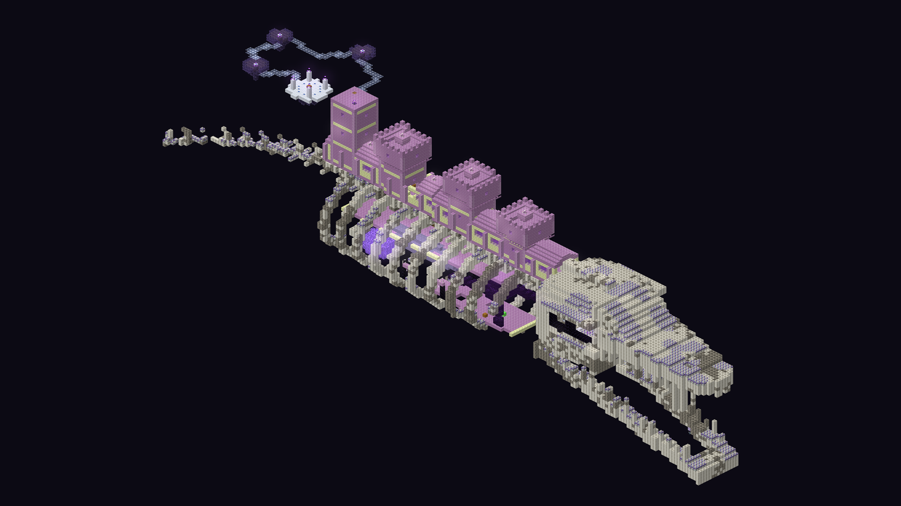

# The Astral End

**The End was never empty. It was waiting.** A Minecraft mod that turns the outer End - everything
beyond 1,000 blocks from the dragon's island - into a sparse sky of drifting islands: quiet, alien, full
of ruins no one is left to explain, and as dangerous as the void beneath them.

[](https://youtu.be/ZUQVTpnqRTQ)

**[Download on Modrinth](https://modrinth.com/mod/the-astral-end)** ·
**[The field guide](https://ggrantrichards.github.io/the-astral-end/)** (every biome, structure and creature) ·
**[The trailer](https://youtu.be/ZUQVTpnqRTQ)**

## Requirements

| Minecraft | Forge | File |
|---|---|---|
| **26.3** | 66 or newer | `astralend-<version>.jar` |
| **1.21.1** | 52.1 or newer | `astralend-<version>-mc1.21.1.jar` |

Install it on the client, and on the server too for multiplayer. Start a new world, or explore past
1,000 blocks from the centre of an old one's End: the mod changes only the outer End, and only where it
hasn't been generated yet. On 1.21.1 the game warns that the world "uses experimental settings" (it
does that for any mod that adds world generation); choose *I know what I'm doing!* to play.

## What's in it



- **Six new biomes on the outer islands, and two caves.**
  - *Nebula Fields*: glowing gas, rose moss and low gravity.
  - *Deep Hollows*: the End's only forest, with the *Hollow Roots* beneath.
  - *Glimmering Crags* and *Shattered Crags*: crystal peaks, with the *Crystal Vaults* below.
  - *Ashen Barrens*: the leviathans' graveyard.
  - *The Gilded Reach*: a rare disc of golden meadow under the star the Sunstorms break from.
- **The Leviathan.** A 370-block skeleton with a purpur citadel on its back: a beating heart, a
  reliquary kept by the Curator (a boss fight that turns upside down halfway), Hollowbacks in its ribs, a
  Constellation Maze on its last tower, and a skull that wakes into a wormhole network.
- **Creatures that live with each other.** Drift Whale pods you can sing to and ride, Hushback herds,
  Hydragrips, the Mirror Wretch, the Watcher, the Umbral Stalker, the Shardback and Pollinators, each
  with its threads to the others.
- **Starforging.** Five sidegrades for diamond and netherite gear at the Astral Forge, each needing a
  template from the Curator, a constellation sighted from the Gilded Reach and a rare material.
- **And:** the Solar Array, the Shattered Observatory and the Comet Craters; Sunstorms; a Lodestar to
  respawn by; new building blocks and a wood set; four music tracks and a disc; ambience for every
  biome; advancements for all of it.

The mod keeps to the End's own palette and tells you things with sound and light: no new armour tiers,
no friendly villagers, no text in your face. [docs/DISTILLATION.md](docs/DISTILLATION.md) has the
design ideas.

## Credits

- **Music** from OpenGameArt.org: "Out There" by yd, "Ambient Relaxing Loop" and "Heavenly Loop" by
  isaiah658, "Observing the Star" by madeso (all CC0), and "Space Music" by HitCtrl (CC-BY 3.0). Full
  list and links in [sounds/credits.txt](src/main/resources/assets/astralend/sounds/credits.txt).
- **Textures** of the commonest blocks start from vanilla's own, recoloured and reworked so they sit
  beside them in the game. Those stay Mojang's and aren't covered by this mod's licence.

## Licence

The mod's code, its own textures and models: MIT (see [LICENSE](LICENSE)).

## Building it

```
python3 tools/generate_resources.py      # the blockstates, models, loot, recipes, worldgen... (src/main/resources)
./gradlew build                          # the jar, in build/libs
```

Every push runs CI (`.github/workflows/build.yml`). It checks the resources, builds, loads the mod in a
server and a real client, surveys a generated End (`dev/WorldgenSurvey.java`), and takes in-game
screenshots and playtests. The **1.21.1** build lives on the `port-1.21` branch: there,
`tools/port/to_1_21.py` converts the generator's output to 1.21.1's formats. Releases go out with the
*Release to Modrinth* workflow (`tools/release/modrinth.py`, with the page in `docs/modrinth/`). The
development history is in [docs/DEVLOG.md](docs/DEVLOG.md).
